# Construção de Compiladores — Resumo: Análise Semântica
## Tradução Dirigida por Sintaxe · BYACC/J · Tabela de Símbolos · Verificação de Tipos
---
> Baseado em: *Tradução Dirigida por Sintaxe (Unid. 4.2)*, *Tabela de Símbolos e Verificação Semântica (Unid. 4.3–4.4)* e o handout *CS143 #13 — Syntax Directed Translation*.

### Índice
1. [O mapa geral](#0-o-mapa-geral)
2. [Parte 1 — Tradução Dirigida por Sintaxe (TDS)](#parte-1--tradução-dirigida-por-sintaxe-tds)
3. [Parte 2 — O modelo do BYACC/J](#parte-2--o-modelo-do-byaccj)
4. [Parte 2.5 — A análise ascendente por trás de tudo](#parte-25--a-análise-ascendente-por-trás-de-tudo)
5. [Parte 3 — Análise semântica & Tabela de Símbolos](#parte-3--análise-semântica--tabela-de-símbolos)
6. [Parte 4 — Escopos](#parte-4--escopos)
7. [Parte 5 — Sistemas de tipos](#parte-5--sistemas-de-tipos)
8. [Parte 6 — Verificador "Mini" com BYACC/J](#parte-6--verificador-mini-com-byaccj)
9. [Cola final](#cola-final)

---

## 0. O mapa geral

Onde a gente tá no compilador:

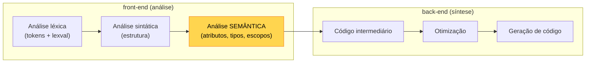

- **Léxico** garante: identificadores válidos, strings fechadas, nada de caractere estranho.
- **Sintático** garante: a *forma* tá certa (expressões e declarações bem montadas).
- **Semântico** garante: o programa *faz sentido*. Variável declarada antes de usar? Tipos batem? Função chamada com o número certo de argumentos?
- A semântica é a **última chance do front-end de rejeitar um programa inválido**.

E a pergunta que amarra tudo: **como a gente calcula "significado" a partir da árvore sintática?** → **Tradução Dirigida por Sintaxe**.

---

## Parte 1 — Tradução Dirigida por Sintaxe (TDS)

### 1.1 A ideia em uma frase

> **A estrutura que o parser reconhece é quem dirige o cálculo do significado.**

A gente "pendura" **atributos** em cada símbolo da gramática e, em cada produção, escreve **regras** (ou **ações**) que calculam esses atributos.

O legal: **a mesma gramática serve pra várias traduções** diferentes, só trocando as regras:

| Entrada `2 + 3 * 4` | Tradução |
|---|---|
| Avaliar | `14` |
| Converter pra pós-fixa | `2 3 4 * +` |
| Construir AST | `+(2, *(3,4))` |
| Verificar tipos | `int` |

Pode rodar **durante o parsing** (uma passada) ou **depois, sobre a árvore** (fase separada).

---

### 1.2 Atributos e SDD (Gramática de Atributos)

- **Atributo**: qualquer propriedade de um símbolo — número, tipo, string, endereço, nó de árvore...
- **Notação**: `X.a` = atributo `a` do símbolo `X`.
- **Regra semântica**: pertence a uma produção e calcula atributos dos símbolos daquela produção.
- **Terminais** recebem atributo **do léxico** (ex.: `digit.lexval`).
- **SDD** (*Syntax-Directed Definition*) = GLC + atributos + regras.
- **Gramática de atributos "pura"** = SDD **sem efeitos colaterais** (só define atributos, não imprime nada, não mexe em tabela).

Exemplo do handout — calcular o valor de um inteiro dígito por dígito:

```
digit -> 0          { digit.val = 0 }
       | 1          { digit.val = 1 }
       ...
       | 9          { digit.val = 9 }

int   -> digit      { int.val = digit.val }
       | int₁ digit { int.val = int₁.val * 10 + digit.val }
```

> `int₁` é só **outra ocorrência** do mesmo não-terminal `int`. O índice serve pra diferenciar qual é qual na regra.

#### Passo a passo: entrada `42`

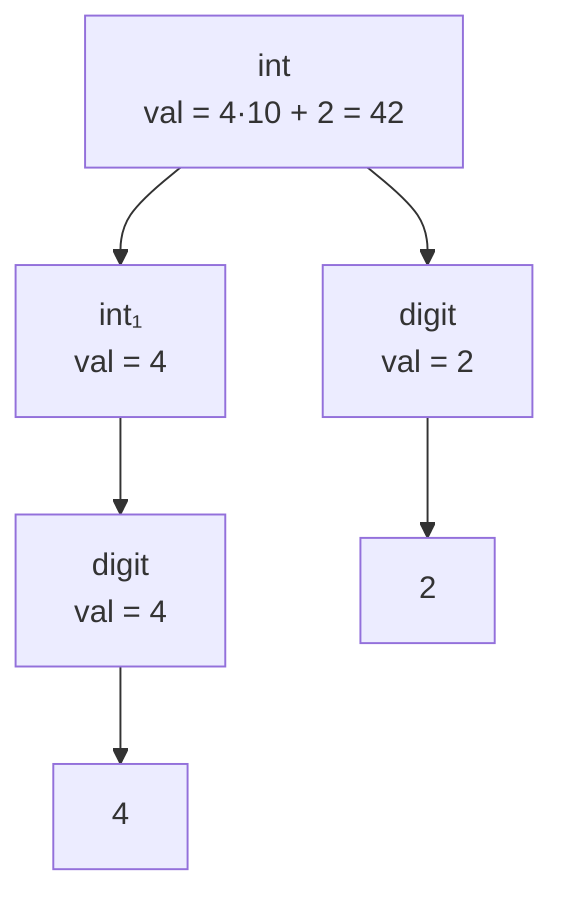

1. O léxico lê `4` → produção `digit -> 4` → `digit.val = 4`.
2. Reduz `int -> digit` → `int₁.val = digit.val = 4`.
3. O léxico lê `2` → `digit.val = 2`.
4. Reduz `int -> int₁ digit` → `int.val = 4 * 10 + 2 = 42`.

**Por quê `*10`?** Cada dígito novo que aparece à direita "empurra" o número anterior uma casa decimal pra esquerda. É exatamente como você converte uma string em número na mão.

---

### 1.3 Sintetizado × Herdado — pra onde a informação anda

Esse é **o** conceito da unidade. Tudo gira em torno disso.

```
     SINTETIZADO (sobe ↑)                 HERDADO (desce ↓ / vai pro lado →)

           X  ← calculado                         X  ─────┐
         ↗ ↑ ↖     a partir                       │       │ pai passa
       Y1  Y2  Y3   dos filhos              Y1 ──→ Y2 ←───┘ pra baixo
                                             irmão à esquerda passa →

  X → Y1 Y2 … Yn                           X → Y1 Y2 … Yn
  X.a = f(Y1.b, …, Yn.k)                   Yk.a = f(X.b, Y1.c, …, Yk-1.d)
```

| | **Sintetizado** | **Herdado** |
|---|---|---|
| Calculado a partir de | filhos (e o próprio nó) | pai e/ou irmãos |
| Direção | sobe na árvore | desce ou vai pro lado |
| Exemplo | valor de expressão, código gerado | tipo declarado, escopo corrente |
| Fácil em... | parser LR (bottom-up) | parser LL (top-down) |

**Macete:** *sintetizado = "o filho conta pro pai"*; *herdado = "o pai (ou o irmão mais velho) avisa o filho"*.

---

### 1.4 Exemplo clássico: a calculadora de mesa (só sintetizados)

| # | Produção | Regra semântica |
|---|---|---|
| 1 | `L → E n` | `L.val = E.val` |
| 2 | `E → E₁ + T` | `E.val = E₁.val + T.val` |
| 3 | `E → T` | `E.val = T.val` |
| 4 | `T → T₁ * F` | `T.val = T₁.val × F.val` |
| 5 | `T → F` | `T.val = F.val` |
| 6 | `F → ( E )` | `F.val = E.val` |
| 7 | `F → digit` | `F.val = digit.lexval` |

> ⚠️ Repare que a regra 1 **não imprime**. Numa gramática de atributos pura só se define atributo. Imprimir é efeito colateral — permitido em SDD/SDT, mas não em gramática de atributos estrita.

#### Passo a passo: **árvore anotada** de `3 * 5 + 4 n`

**Árvore anotada** = árvore de derivação mostrando o valor dos atributos em cada nó.

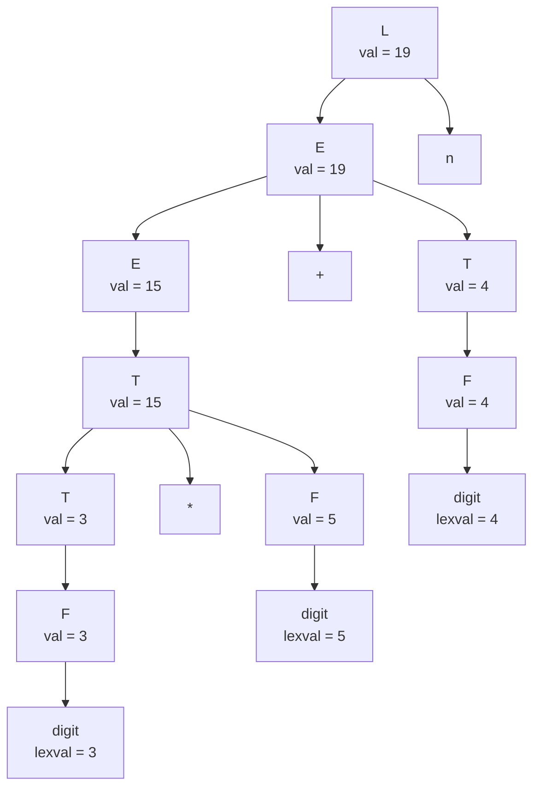

Ordem de cálculo (de baixo pra cima — **pós-ordem**):

| Passo | Nó | Regra usada | Valor | Por quê |
|---|---|---|---|---|
| 1 | `digit` (3) | — | `lexval = 3` | veio do léxico |
| 2 | `F` | 7: `F.val = digit.lexval` | 3 | copia do filho |
| 3 | `T` | 5: `T.val = F.val` | 3 | copia do filho |
| 4 | `digit` (5) | — | `lexval = 5` | léxico |
| 5 | `F` | 7 | 5 | copia |
| 6 | `T` | 4: `T.val = T₁.val × F.val` | 3 × 5 = **15** | o `*` fica mais embaixo na árvore → é calculado primeiro (precedência!) |
| 7 | `E` | 3: `E.val = T.val` | 15 | copia |
| 8 | `digit` (4) → `F` → `T` | 7, 5 | 4 | cadeia de cópias |
| 9 | `E` | 2: `E.val = E₁.val + T.val` | 15 + 4 = **19** | soma |
| 10 | `L` | 1: `L.val = E.val` | **19** | resultado final |

**Sacada importante:** a **precedência** não está nas regras semânticas — ela já está codificada na **forma da árvore**. O `*` ficou mais fundo, então foi calculado antes. As regras só "seguem" a árvore.

> Qualquer percurso **pós-ordem** avalia corretamente uma SDD que só tem sintetizados.

---

### 1.5 Exemplo de herdado: declarações `float x, y`

Aqui o tipo tem que **descer** da palavra `float` até cada identificador.

```
D  → T L        { L.inh = T.type }
T  → int        { T.type = integer }
T  → float      { T.type = float }
L  → L₁ , id    { L₁.inh = L.inh;  addType(id.entry, L.inh) }
L  → id         { addType(id.entry, L.inh) }
```

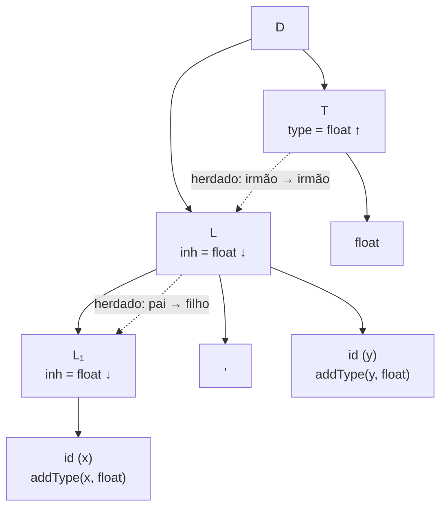

#### Passo a passo

1. `T → float` → `T.type = float`. Isso é **sintetizado** (sobe da folha `float` pra `T`).
2. `D → T L` → `L.inh = T.type = float`. Agora é **herdado**: vai do **irmão à esquerda** (`T`) pro `L`.
3. `L → L₁ , id` → `L₁.inh = L.inh = float`. **Herdado** de novo: do **pai** (`L`) pro filho (`L₁`).
4. `L₁ → id(x)` → `addType(x, float)`. O `x` ganha o tipo na tabela.
5. Volta pra `L → L₁ , id(y)` → `addType(y, float)`.

**Por que precisa de herdado aqui?** Porque quem *sabe* o tipo (`T`) está **à esquerda e ao lado** de quem *precisa* dele (os `id`). Informação lateral/descendente = herdado.

---

### 1.6 Grafo de dependências e ordem de avaliação

Pergunta: **quem precisa ser calculado antes de quem?**

- **Grafo de dependências**: um vértice por **instância de atributo** na árvore; aresta `a → b` se a regra que calcula `b` **usa** `a`.
- **Ordem válida** = qualquer **ordenação topológica** desse grafo (aquilo de AEST II: "só processa um nó depois de todos que apontam pra ele").
- **Ciclo** ⇒ não existe ordem ⇒ a SDD é **circular** pra aquela árvore.
- Testar circularidade pra **qualquer** árvore é **exponencial** ⇒ na prática usamos **classes restritas** de SDD que garantem uma ordem simples.

Exemplo para a regra `E → E₁ + T`:

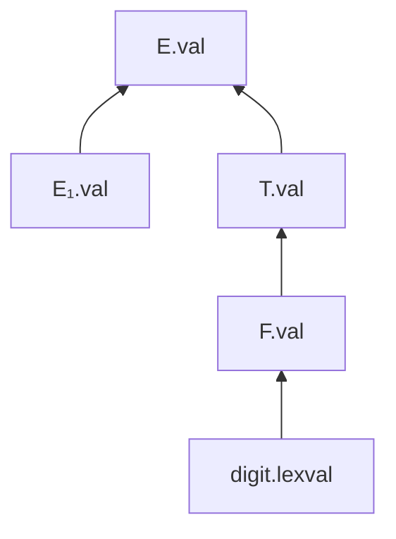

Uma ordem topológica possível: `digit.lexval → E₁.val → F.val → T.val → E.val`.
(Repara que `E₁.val` e a cadeia `digit→F→T` são independentes — podem vir em qualquer ordem entre si, só precisam vir antes de `E.val`.)

---

### 1.7 S-atribuída × L-atribuída

```
 ┌───────────────────────── SDD em geral ─────────────────────────┐
 │   ┌──────────────── L-atribuídas ────────────────┐             │
 │   │  (ex.: declarações float x, y)               │             │
 │   │   ┌──────── S-atribuídas ───────┐            │             │
 │   │   │  (ex.: calculadora de mesa) │            │             │
 │   │   └─────────────────────────────┘            │             │
 │   └──────────────────────────────────────────────┘             │
 └────────────────────────────────────────────────────────────────┘
                  S-atribuída ⊂ L-atribuída ⊂ SDD
```

| | **S-atribuída** | **L-atribuída** |
|---|---|---|
| Regra | **todos** os atributos são sintetizados | herdados de `Xᵢ` dependem **só** de herdados do pai e de atributos dos irmãos **à esquerda** (`X₁ … Xᵢ₋₁`) |
| Avaliação | um percurso **pós-ordem** | um percurso **em profundidade, esquerda → direita** |
| Casa com | **parser LR** (avalia na redução) — modelo nativo do yacc/BYACC/J | **descendente recursivo / LL** |
| Em LR | trivial | exige truques (marcadores, `$0`) |

**Por que "L"?** De *Left*: a informação só pode vir **da esquerda** (ou de cima). Nunca de um irmão à direita, porque num percurso esquerda→direita ele ainda não foi visitado.

#### Exemplo L-atribuído: `T → F T'` (gramática sem recursão à esquerda)

Quando você tira a recursão à esquerda (pra usar LL), o operando esquerdo fica "separado" do operador. A solução: **herdar o valor parcial pra direita**.

```
T  → F T'        T'.inh = F.val          T.val  = T'.syn
T' → * F T'₁     T'₁.inh = T'.inh × F.val T'.syn = T'₁.syn
T' → ε           T'.syn = T'.inh
F  → digit       F.val = digit.lexval
```

#### Passo a passo: entrada `3 * 5`

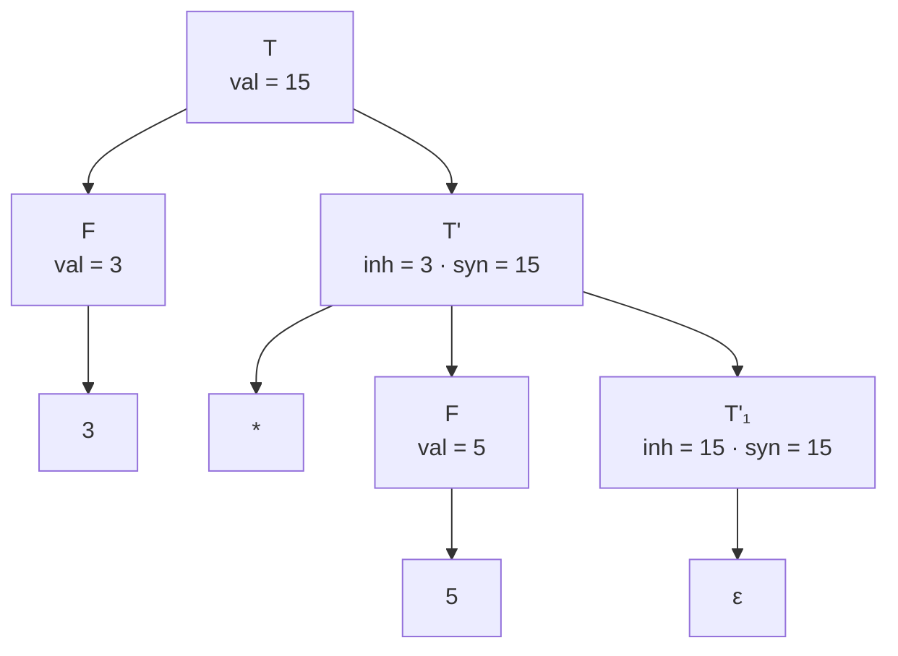

1. `F.val = 3` (do léxico).
2. `T'.inh = F.val = 3` → o "acumulado até agora" desce pra `T'`. *(herdado do irmão à esquerda)*
3. Dentro de `T'`: lê `*`, depois `F.val = 5`.
4. `T'₁.inh = T'.inh × F.val = 3 × 5 = 15` → acumulado atualizado desce pro próximo `T'`. *(herdado do pai + irmão à esquerda)*
5. `T'₁ → ε`: acabou a entrada → `T'₁.syn = T'₁.inh = 15`. **Aqui o valor "vira" e começa a subir.**
6. `T'.syn = T'₁.syn = 15` *(sintetizado)*.
7. `T.val = T'.syn = 15` *(sintetizado)*.

**Resumo visual do fluxo:** `inh` desce pela direita acumulando → bate no `ε` → `syn` volta subindo com o resultado.

> É **L-atribuída** (herdados só usam pai e irmão à esquerda) mas **não** é S-atribuída (tem herdado).

---

### 1.8 Exemplo misto: "declarar antes de usar"

```
P  → D S             { S.dl = D.dl }
D  → var V ; D₁      { D.dl = addList(V.name, D₁.dl) }
   | ε               { D.dl = null }
S  → V := E ; S₁     { check(V.name, S.dl);  S₁.dl = S.dl }
   | ε
V  → x | y | z       { V.name = "x" / "y" / "z" }
```

Entrada:
```
var x; var y;
x := ...; y := ...;
```

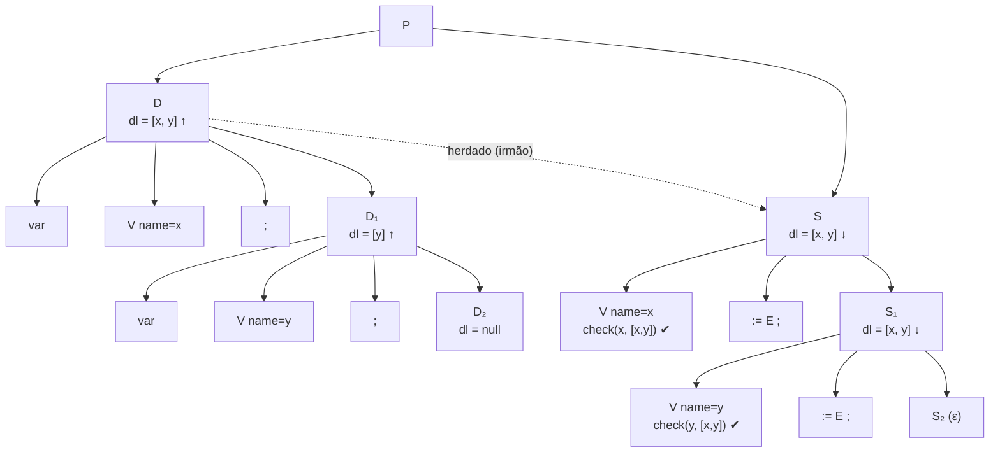

**Passo a passo:**
1. **Parte das declarações (sintetizado ↑):** o `D` mais fundo é `ε` → `dl = null`. Subindo: `D₁.dl = addList("y", null) = [y]`. Subindo: `D.dl = addList("x", [y]) = [x, y]`.
2. **Ponte (herdado →):** `P → D S` faz `S.dl = D.dl = [x, y]`. A lista passa do irmão da esquerda pro da direita.
3. **Parte dos comandos (herdado ↓):** cada `S` faz `check(V.name, S.dl)` e repassa a lista pro `S₁`.
4. Se aparecesse `z := ...`, `check("z", [x,y])` falharia → **erro semântico**.

| Atributo | Tipo |
|---|---|
| `V.name` | sintetizado (vem do léxico) |
| `D.dl` | sintetizado (lista montada de baixo pra cima) |
| `S.dl` | herdado (vem do irmão `D` e do pai `S`) |

Classe: **L-atribuída** (não é S, porque tem herdado).

---

### 1.9 Esquemas de Tradução (SDT)

- **SDT** = gramática com **pedaços de código** `{ ... }` **dentro** do corpo das produções.
- A ação roda **assim que tudo à esquerda dela foi reconhecido**.
- **SDD diz *o quê*; SDT diz *o quê* e *quando*.**
- Todo SDD S- ou L-atribuído pode virar SDT.

Exemplo: infixa → pós-fixa

```
E → E + T   { print('+') }
E → E - T   { print('-') }
E → T
T → 0       { print('0') }
...
T → 9       { print('9') }
```

#### Passo a passo: `9-5+2` → `95-2+`

Árvore (a gramática é recursiva à esquerda, então agrupa `(9-5)+2`):

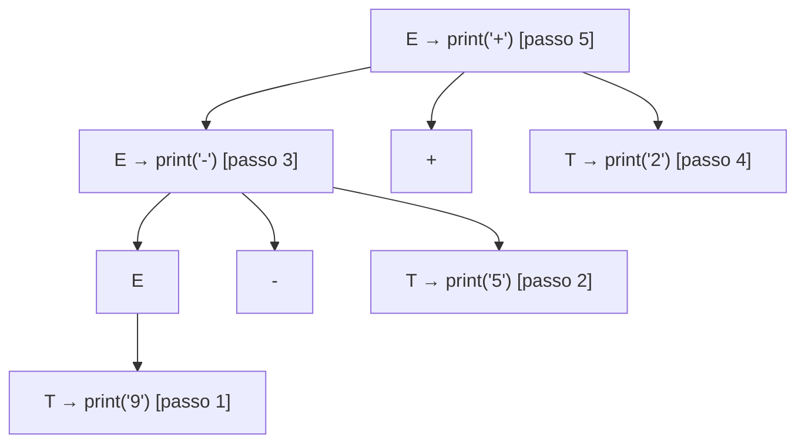

| Passo | O que foi reconhecido | Ação | Saída acumulada |
|---|---|---|---|
| 1 | `T → 9` | `print('9')` | `9` |
| 2 | `T → 5` | `print('5')` | `95` |
| 3 | `E → E - T` (inteiro reconhecido) | `print('-')` | `95-` |
| 4 | `T → 2` | `print('2')` | `95-2` |
| 5 | `E → E + T` | `print('+')` | `95-2+` |

**Por quê funciona?** A ação do operador está **no fim** da produção, então só roda **depois** dos dois operandos terem sido impressos. Isso é literalmente um percurso pós-ordem.

#### SDT pós-fixo e ações no meio da regra

- **SDT pós-fixo**: todas as ações **no final** das produções. Num parser LR, a ação roda **na redução** — é exatamente o que o yacc faz. **S-atribuída ⇒ SDT pós-fixo de graça.**
- **Ação no meio** (`B → X { a } Y`): o gerador cria um **marcador** vazio:

```
antes:                    depois (o que o gerador faz):
B → X { a } Y             B → X M Y
                          M → ε   { a }
```

> ⚠️ Esse marcador `M → ε` pode **criar conflitos** que a gramática original não tinha (o parser passa a ter que decidir "reduzo `M` agora ou não?").

#### Regra prática: SDD L-atribuída → SDT

- **Herdado de `A`** → ação **imediatamente antes** de `A`.
- **Sintetizado da cabeça** → ação **no final**.

```
T  → F { T'.inh = F.val } T' { T.val = T'.syn }
T' → * F { T'₁.inh = T'.inh * F.val } T'₁ { T'.syn = T'₁.syn }
T' → ε { T'.syn = T'.inh }
F  → digit { F.val = digit.lexval }
```

Garantia: quando a ação roda, **tudo o que ela usa já foi calculado** (está à esquerda).

---

### 1.10 TDS num parser descendente recursivo (LL)

A tradução é direta:
- **Um método por não-terminal.**
- **Herdado ⇒ parâmetro.**
- **Sintetizado ⇒ valor de retorno.**

```java
// T -> F T'
int T() {
    int f = F();
    return Tlinha(f);          // T'.inh = F.val
}

// T' -> * F T'1 | ε
int Tlinha(int inh) {          // herdado = parâmetro
    if (la == '*') {
        match('*');
        int f = F();
        return Tlinha(inh * f); // T'1.inh = T'.inh * F.val
    }
    return inh;                 // T'.syn = T'.inh
}

// F -> digit
int F() {
    int v = lexval;             // valor do token
    match(DIGIT);
    return v;                   // sintetizado = retorno
}
```

#### Passo a passo: `3 * 5 * 2`

```
T()
 ├─ F() → 3
 └─ Tlinha(3)            la = '*'  → consome '*', F() → 5
     └─ Tlinha(15)       la = '*'  → consome '*', F() → 2
         └─ Tlinha(30)   la = fim  → return 30
         ← 30
     ← 30
 ← 30
```

1. `T()` chama `F()`, que lê o `3` e retorna `3`.
2. `T()` chama `Tlinha(3)` — o `3` é o herdado, entrando como parâmetro.
3. `Tlinha(3)` vê `*`, consome, chama `F()` → `5`, e chama `Tlinha(3*5) = Tlinha(15)`.
4. `Tlinha(15)` vê `*`, consome, `F()` → `2`, chama `Tlinha(30)`.
5. `Tlinha(30)` não vê mais `*` → caso `ε` → `return 30` (o herdado vira sintetizado).
6. O `30` volta subindo pela pilha de chamadas.

#### Exemplo do handout: cliente FTP

O handout mostra a mesma ideia num cliente FTP:
- `ParseLogin()` chama `ParseUser()` e `ParsePassword()`, que **retornam** o usuário e a senha (**sintetizados**), e devolve uma `Connection` (**sintetizado**, sobe).
- `ParseCommands()` guarda essa conexão e **passa como parâmetro** para `ParseGet(conn)` e `ParseLogout(conn)` → **herdado**: esses comandos recebem informação sobre partes do parsing que já aconteceram (irmãos à esquerda).

---

### 1.11 TDS num parser ascendente (LR)

Uma **pilha de valores** anda **junto** com a pilha de estados:

- **Shift**: empilha o estado + o `lexval` do token.
- **Reduce `A → X₁…Xₙ`**: os `n` valores do topo são o corpo; a ação calcula o valor de `A`, desempilha `n` entradas e empilha `A` com o novo valor.

Exemplo: reduzindo `E → E + T` com `val = 2 + 12`:

```
   ANTES (topo em cima)           DEPOIS
  ┌─────────┬───────┐           ┌─────────┬───────┐
  │ símbolo │ valor │           │ símbolo │ valor │
  ├─────────┼───────┤           ├─────────┼───────┤
  │   T     │  12   │ ← topo    │   E     │  14   │ ← topo
  │   +     │   —   │           │   $     │       │
  │   E     │   2   │           └─────────┴───────┘
  │   $     │       │
  └─────────┴───────┘
        3 entradas saem → 1 entra (E = 2 + 12)
```

No yacc, "os n valores do topo" ganham nomes: **`$1 … $n`** pro corpo e **`$$`** pra cabeça.

#### Por que herdado é difícil no LR?

> No LR o nó **pai só é criado na redução**, **depois** que todos os filhos foram reconhecidos. Enquanto os filhos são processados, **não existe pai** de onde herdar.

As três saídas usadas na prática:

| # | Saída | Exemplo |
|---|---|---|
| 1 | **Reescrever como sintetizado** — monta uma lista e aplica no pai | `D : T L { for (id : $2) addType(id, $1); }` |
| 2 | **Olhar abaixo na pilha com `$0`** — se o valor está sempre logo abaixo do corpo | `L : L ',' ID { addType($3, $0); }` |
| 3 | **Estado global** — guardar contexto em variáveis do parser | `T : FLOAT { tipoAtual = "float"; }` |

---

## Parte 2 — O modelo do BYACC/J

### 2.1 Visão geral

BYACC/J = **Berkeley Yacc com saída Java**. Gera um parser **LALR(1)** com **SDT pós-fixo**.

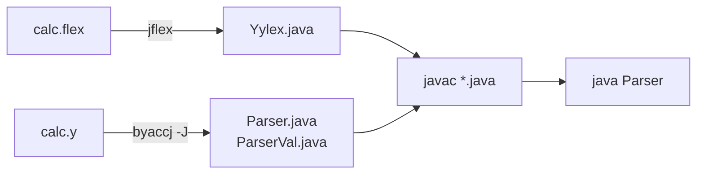

```bash
$ jflex calc.flex      # -> Yylex.java
$ byaccj -J calc.y     # -> Parser.java, ParserVal.java
$ javac *.java
$ java Parser
x=2+3*4
x = 14.0
```

- Mesma sintaxe do yacc.
- Ações em **Java**; gera uma classe `Parser`.
- Valores semânticos: classe **`ParserVal`** (no lugar do `%union` do C).

### 2.2 Estrutura do arquivo `.y`

Três seções separadas por `%%`:

```
%{
  import java.io.*;          ← vai pro TOPO do Parser.java (imports)
  import java.util.*;
%}
%token NL                    ┐
%token <dval> NUM            │  DECLARAÇÕES: tokens, tipos,
%type  <dval> exp            │  precedência, associatividade
%left '+' '-'                ┘
%%
exp : exp '+' exp  { $$ = $1 + $3; }     ┐  REGRAS: produções
    | NUM          { $$ = $1; }          │  + ações em Java
    ;                                    ┘
%%
private int yylex() { ... }              ┐  CÓDIGO DO USUÁRIO: campos e
public void yyerror(String s) { ... }    ┘  métodos DENTRO da classe Parser
```

### 2.3 `ParserVal`: o valor de cada símbolo da pilha

```java
public class ParserVal {        // gerado
    public int    ival;
    public double dval;
    public String sval;
    public Object obj;
    // um construtor para cada tipo
}
```

- A pilha de valores é um `ParserVal[]`.
- **`yylval`**: valor do token corrente (preenchido pelo **scanner**).
- **`yyval`**: valor da cabeça sendo reduzida (`$$`).
- Cada símbolo usa o campo que faz sentido: número em `dval`, identificador em `sval`, nó de árvore em `obj`.

| yacc (C) | BYACC/J |
|---|---|
| `%union { int i; char *s; }` | `ParserVal` com campos fixos `ival / dval / sval / obj` |

### 2.4 Pseudovariáveis `$$`, `$1 … $n`, `$0`

| Na ação | Significa | No código gerado |
|---|---|---|
| `$$` | valor da cabeça (resultado) | `yyval` |
| `$1` | 1º símbolo do corpo | `val_peek(n-1)` |
| `$k` | k-ésimo símbolo do corpo | `val_peek(n-k)` |
| `$n` | último símbolo (topo) | `val_peek(0)` |
| `$0` | símbolo **abaixo** do corpo | `val_peek(n)` |

> `n` = tamanho do corpo; `val_peek(i)` = `i` posições abaixo do topo.

Visualizando `exp : exp '+' exp` (n = 3):

```
  pilha de valores          na ação       no Java
  ┌──────────┐
  │   exp    │ ← topo       $3       →   val_peek(0)
  │   '+'    │              $2       →   val_peek(1)
  │   exp    │              $1       →   val_peek(2)
  │ (abaixo) │              $0       →   val_peek(3)
  └──────────┘
```

```
{ $$ = $1 + $3; }   →   yyval.dval = val_peek(2).dval + val_peek(0).dval;
```

> ⚠️ **Ação padrão:** antes da sua ação, o gerador faz `$$ = $1`. Por isso `exp : '(' exp ')'` **precisa** de `{ $$ = $2; }` — senão o valor seria o do parêntese `(`!

### 2.5 Tipando os símbolos: `%token <campo>` e `%type <campo>`

```
SEM TIPOS                               COM TIPOS (recomendado)
%token NUM                              %token <dval> NUM
%%                                      %type  <dval> exp
exp : exp '+' exp                       %%
      { $$.dval = $1.dval + $3.dval; }  exp : exp '+' exp  { $$ = $1 + $3; }
    | NUM                                   | NUM          { $$ = $1; }
      { $$.dval = $1.dval; }
```

- `%token <f>` tipa **terminais**; `%type <f>` tipa **não-terminais**.
- Campos válidos: `ival`, `dval`, `sval`, `obj`.

> ⚠️ **Misturar campos é erro silencioso**: se o scanner grava em `dval` e a ação lê `ival`, você recebe `0`, **sem exceção**.
> ⚠️ Em `obj` o valor é `Object`: precisa de **cast** pra usar.

### 2.6 Integração com JFlex: quem preenche `yylval`?

```java
%%
%byaccj
%{
  private Parser yyparser;
  public Yylex(Reader r, Parser yyparser) { this(r); this.yyparser = yyparser; }
%}
NUM = [0-9]+ ("." [0-9]+)?
ID  = [a-zA-Z_][a-zA-Z0-9_]*
%%
"+"|"-"|"*"|"/"|"="|"("|")"  { return (int) yycharat(0); }
{NUM}  { yyparser.yylval = new ParserVal(Double.parseDouble(yytext()));
         return Parser.NUM; }
{ID}   { yyparser.yylval = new ParserVal(yytext());
         return Parser.ID; }
[ \t]+ { /* ignora */ }
```

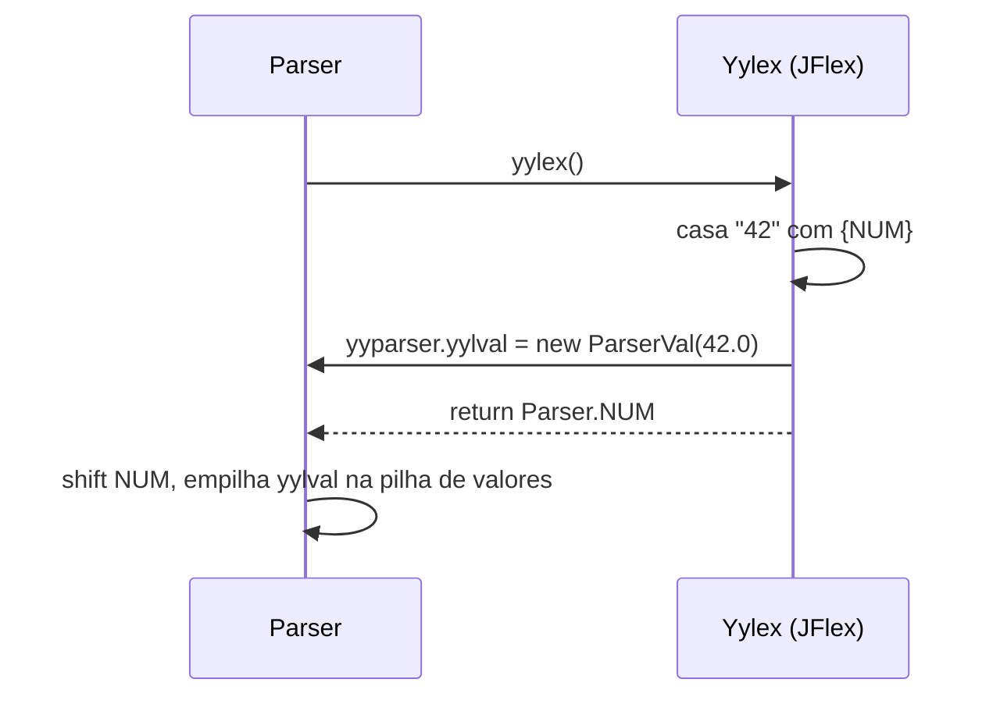

- `%byaccj`: `yylex()` retorna `int`; fim de arquivo ⇒ `0`.
- O scanner recebe a **referência do parser** pra conseguir escrever em `yylval`.
- Token de 1 caractere: devolve o próprio código `(int) yycharat(0)`.
- Retorno `< 0` = erro léxico.
- **É aqui que nascem os atributos dos terminais** (o `lexval` do Aho).

### 2.7 Exemplo completo: calculadora com variáveis

```
%token NL
%token <dval> NUM
%token <sval> ID
%type  <dval> exp
%left '+' '-'
%left '*' '/'
%left NEG
%%
input : /* vazio */ | input linha ;

linha : NL
      | exp NL          { System.out.println(" = " + $1); }
      | ID '=' exp NL   { mem.put($1, $3); System.out.println($1 + " = " + $3); }
      | error NL        { System.err.println("linha descartada"); }
      ;
exp : NUM               { $$ = $1; }
    | ID                { $$ = consulta($1); }
    | exp '+' exp       { $$ = $1 + $3; }
    | exp '-' exp       { $$ = $1 - $3; }
    | exp '*' exp       { $$ = $1 * $3; }
    | exp '/' exp       { if ($3 == 0) { yyerror("divisão por zero"); $$ = 0; }
                          else $$ = $1 / $3; }
    | '-' exp %prec NEG { $$ = -$2; }
    | '(' exp ')'       { $$ = $2; }
    ;
%%
private final Map<String, Double> mem = new HashMap<>();   // tabela de símbolos
private double consulta(String nome) {
    Double v = mem.get(nome);
    if (v == null) { yyerror("variável não definida: " + nome); return 0; }
    return v;
}
// + yylex(), yyerror(), construtor, main...
```

- `yylex()` e `yyerror(String)` são **obrigatórios**.
- `yyparse()` devolve `0` se a entrada foi aceita.
- `mem` é **estado global** do parser (saída nº 3 pra contexto).
- **Erros semânticos** (divisão por zero, variável indefinida) são detectados **nas ações**, não pelo parser.

### 2.8 ⭐ Passo a passo: rastreando a pilha de valores em `2 + 3 * 4 NL`

| # | Pilha de símbolos | Pilha de valores | Ação |
|---|---|---|---|
| 1 | `$` | | shift `NUM` (`yylval = 2`) |
| 2 | `$ NUM` | `2` | reduce `exp → NUM` (`$$ = $1`) |
| 3 | `$ exp` | `2` | shift `+` |
| 4 | `$ exp + NUM` | `2 – 3` | reduce `exp → NUM` |
| 5 | `$ exp + exp` | `2 – 3` | **shift `*`** (prec `*` > `+`) |
| 6 | `$ exp + exp * NUM` | `2 – 3 – 4` | reduce `exp → NUM` |
| 7 | `$ exp + exp * exp` | `2 – 3 – 4` | reduce `exp → exp * exp` (`$$ = 3*4`) |
| 8 | `$ exp + exp` | `2 – 12` | reduce `exp → exp + exp` (`$$ = 2+12`) |
| 9 | `$ exp` | `14` | shift `NL`; reduce `linha → exp NL` (imprime 14) |

> "–" marca a posição de um token sem valor útil (o valor existe na pilha, mas ninguém usa).

**Explicando cada momento:**

- **Passos 1–2:** o scanner lê `2`, coloca em `yylval`, o parser dá shift (empilha `NUM` com valor `2`). Como `NUM` sozinho é o corpo de `exp → NUM`, reduz: `$$ = $1` → `exp` com valor `2`.
- **Passos 3–4:** shift do `+` (valor irrelevante), depois shift de `3` e redução pra `exp(3)`.
- **Passo 5 — o momento crítico:** a pilha tem `exp + exp`, que **já casa** com `exp → exp + exp`. O parser poderia reduzir agora... mas o próximo token é `*`. Isso é um **conflito shift/reduce**, resolvido pela **precedência**: `*` foi declarado **depois** de `+` (`%left '*' '/'` vem abaixo de `%left '+' '-'`), então tem precedência maior → **shift**. Se reduzisse aqui, calcularia `(2+3)*4 = 20`. Errado!
- **Passos 6–7:** empilha `4`, reduz pra `exp(4)`. Agora o topo é `exp * exp` → reduz: `$1 = 3`, `$3 = 4`, `$$ = 12`. Três entradas saem, uma `exp(12)` entra.
- **Passo 8:** topo é `exp + exp` com valores `2` e `12` → reduz: `$$ = 2 + 12 = 14`.
- **Passo 9:** lê `NL`, reduz `linha → exp NL`, e a ação imprime ` = 14`.

### 2.9 Ações no meio da regra e o truque do `$0`

**Ação no meio — abrir/fechar escopo:**

```
bloco : '{'  { tabela.abreEscopo(); }  comandos  '}'  { tabela.fechaEscopo(); } ;
         $1           $2                  $3      $4
```

> A ação do meio **conta como símbolo**: ela é o `$2` e `comandos` vira `$3`. Um marcador ε é criado — cuidado com conflitos novos.

**Herdado via `$0` — `float x, y;`:**

```
decl  : tipo lista ';' ;
tipo  : INT    { $$ = "int"; }
      | FLOAT  { $$ = "float"; } ;
lista : lista ',' ID  { addType($3, $<sval>0); }
      | ID            { addType($1, $<sval>0); } ;
```

#### Passo a passo da pilha em `float x, y;`

```
 (1) reduzindo  lista → ID   (n = 1)        (2) reduzindo  lista → lista ',' ID   (n = 3)

   ┌──────────────┐                            ┌──────────────┐
   │ ID  "x"      │ ← $1 = val_peek(0)         │ ID  "y"      │ ← $3 = val_peek(0)
   │ tipo "float" │ ← $0 = val_peek(1) ★       │ ','          │ ← $2
   │ $            │                            │ lista        │ ← $1
   └──────────────┘                            │ tipo "float" │ ← $0 = val_peek(3) ★
   addType("x", "float")                       │ $            │
                                               └──────────────┘
                                               addType("y", "float")
```

1. Lê `float` → reduz `tipo → FLOAT`, `$$ = "float"`. Agora `tipo("float")` está na pilha.
2. Lê `x` → shift `ID("x")`. Reduz `lista → ID`: o corpo tem 1 símbolo, então `$0` é **quem está logo abaixo** → o `tipo`! → `addType("x", "float")`.
3. Lê `,` e `y`. Reduz `lista → lista ',' ID`: corpo de 3 símbolos, `$0` está 3 posições abaixo do topo → **de novo o `tipo`**! → `addType("y", "float")`.

**Por que funciona?** Porque `lista` **sempre** aparece logo depois de `tipo` na gramática. Então, não importa o quanto a lista cresça, o `tipo` está sempre logo abaixo dela.

> ⚠️ `$0` só funciona se o **contexto for sempre o mesmo**. Se `lista` aparecesse em outro lugar sem `tipo` antes, `$0` pegaria lixo.
> O `$<sval>0` é necessário porque o BYACC/J não sabe o tipo de `$0` (ele não pertence à produção) — você diz o campo na mão.

### 2.10 Precedência, associatividade e `%prec`

```
%left  '+' '-'     /* menor precedência */
%left  '*' '/'
%left  NEG         /* token fictício */
%right '^'         /* maior precedência */
%%
exp : '-' exp %prec NEG { $$ = -$2; }
```

| Declaração | Efeito |
|---|---|
| `%left` | `a op b op c = (a op b) op c` |
| `%right` | `a op b op c = a op (b op c)` |
| `%nonassoc` | `a op b op c` é **erro de sintaxe** |
| `%prec T` | a regra usa a precedência de `T` |

- **Linhas posteriores têm precedência maior.**
- Conflitos shift/reduce entre operadores declarados são resolvidos **em silêncio**; os outros aparecem no relatório (`-v`).

**Exemplos explicados:**
- `2 - 3 - 4` → `-` é `%left` → `(2-3)-4 = -5`.
- `2 ^ 3 ^ 2` → `^` é `%right` → `2^(3^2) = 2^9 = 512`.
- `-2 ^ 2` → `^` tem precedência maior que `NEG` → `-(2^2) = -4`.

**Por que o `NEG` fictício?** O `-` já tem a precedência baixa do `%left '+' '-'`. O menos **unário** precisa de uma precedência mais alta, então você cria um token "de mentira" só pra emprestar a precedência dele com `%prec NEG`.

### 2.11 Erros sintáticos e semânticos

```
linha : exp NL    { System.out.println($1); }
      | error NL  { System.err.println("linha descartada"); }
      ;
```

O que acontece com o token especial `error`:
1. Parser encontra token inesperado → chama `yyerror("syntax error")`.
2. **Desempilha estados** até achar um que aceite o token `error`.
3. **Descarta tokens** até achar um que possa vir depois (`NL`).
4. Executa a ação da regra de erro e **continua**.

> ⚠️ **Erros semânticos não são detectados pelo parser** — quem decide são as **ações**.
> **Boa prática:** reportar e continuar, dando um valor "neutro" pro `$$` pra evitar erros em cascata.

### 2.12 Opções de linha de comando

| Opção | Efeito |
|---|---|
| `-J` | gera Java (`Parser.java` + `ParserVal.java`) |
| `-Jclass=Nome` | nome da classe do parser |
| `-Jpackage=pkg` | declaração de package |
| `-Jsemantic=Tipo` | usa `Tipo` como valor semântico no lugar de `ParserVal` |
| `-Jextends=C` / `-Jimplements=I` | herança / interfaces |
| `-Jnorun` / `-Jnoconstruct` | não gera `run()` / construtores padrão |
| `-Jthrows=Exc` | exceções declaradas em `yyparse()` |
| `-Jstack=N` | tamanho da pilha (padrão 500) |
| `-v` | gera `y.output` (estados e conflitos) — **sempre use ao depurar conflitos** |

### 2.13 Construindo ASTs com BYACC/J

**Árvore de derivação × AST** pra `2 + 3 * 4`:

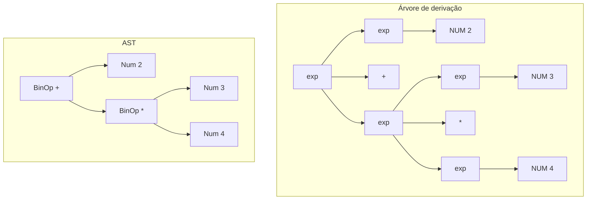

**AST**: nós internos = operadores/construções; filhos = operandos. **Somem** os não-terminais "de encadeamento" (`exp → NUM`), parênteses e separadores. A precedência já está codificada na **forma** da árvore.

**Nós em Java (records + sealed):**

```java
sealed interface Expr permits Num, Var, Neg, BinOp {}
record Num(double v)                      implements Expr {}
record Var(String nome)                   implements Expr {}
record Neg(Expr e)                        implements Expr {}
record BinOp(char op, Expr l, Expr r)     implements Expr {}

static double eval(Expr e, Map<String, Double> env) {
    return switch (e) {
        case Num n   -> n.v();
        case Var v   -> env.getOrDefault(v.nome(), 0.0);
        case Neg n   -> -eval(n.e(), env);
        case BinOp b -> aplica(b.op(), eval(b.l(), env), eval(b.r(), env));
    };
}
```

- `sealed`: o compilador conhece **todos** os tipos de nó → o `switch` é verificado quanto a exaustividade.
- `record`: nós imutáveis, construtor e acessores de graça.

**Ações que constroem a AST:**

```
%type <obj> exp
%%
prog : exp NL          { raiz = (Expr) $1; } ;
exp  : exp '+' exp     { $$ = new BinOp('+', (Expr)$1, (Expr)$3); }
     | exp '*' exp     { $$ = new BinOp('*', (Expr)$1, (Expr)$3); }
     | '-' exp %prec NEG { $$ = new Neg((Expr)$2); }
     | '(' exp ')'     { $$ = $2; }          // parênteses somem!
     | NUM             { $$ = new Num($1); } // terminais viram folhas
     | ID              { $$ = new Var($1); }
     ;
```

**Passo a passo pra `2 + 3 * 4`:** mesma sequência de reduções da seção 2.8, mas cada redução **cria um nó** em vez de calcular um número:
1. `NUM(2)` → `new Num(2)`
2. `NUM(3)` → `new Num(3)`
3. `NUM(4)` → `new Num(4)`
4. `exp * exp` → `new BinOp('*', Num(3), Num(4))`
5. `exp + exp` → `new BinOp('+', Num(2), BinOp('*', ...))`
6. `prog` → `raiz = BinOp('+', ...)`

> Continua sendo **S-atribuída**: o atributo sintetizado de cada `exp` agora é um **nó**.
> Dica: com `byaccj -J -Jsemantic=Expr` a pilha vira de `Expr` — **sem casts**.

**Duas formas de traduzir:**

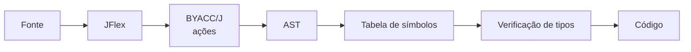

| Avaliar nas ações | Construir AST |
|---|---|
| simples, **uma passada** | permite **várias análises**, referências pra frente, otimizações |
| bom pra calculadoras e tradutores diretos | **padrão em compiladores reais** |

---

## Parte 2.5 — A análise ascendente por trás de tudo

> Liga o conteúdo das [Aula13](../aula13.md) e [Aula14](../aula14.md) (shift-reduce, itens LR, tabelas Action/GoTo, LALR) com o que vimos até aqui.

### 2.5.1 A ideia: o parser LR é o "motor" da TDS

O BYACC/J gera um parser **LALR(1)**, ou seja, um parser **ascendente**. Praticamente tudo que apareceu nas Partes 1 e 2 é **consequência direta** de como um parser LR funciona:

| O que o documento disse | Por que acontece, olhando pelo LR |
|---|---|
| S-atribuída "casa perfeitamente com LR" | o LR monta a árvore **de baixo pra cima**: na hora de um **reduce**, todos os filhos já foram reconhecidos → dá pra calcular o pai |
| As ações do yacc rodam "no final da produção" (SDT pós-fixo) | uma ação só pode rodar quando a produção **inteira** está no topo da pilha (o **handle**) → isso é o **reduce** |
| `$1 … $n` | são os `n` valores do **handle**, que estão no topo da pilha de valores |
| `$$` | o valor que vai ser empilhado junto com o estado do **GoTo** depois do reduce |
| Herdado é difícil no LR | o nó pai **só nasce no reduce**, quando os filhos já acabaram → não tem de quem herdar enquanto os filhos são processados |
| `$0` funciona | é a entrada da pilha **logo abaixo** do handle, que já foi reconhecida e está lá parada |
| Ação no meio cria marcador `M → ε` e "pode gerar conflito" | a produção ε vira um **item novo** num estado; o parser tem que decidir se reduz `M` **antes** de ver o resto → conflito shift/reduce |
| `%left`, `%right`, `%prec` | são **regras pra preencher a tabela Action** quando ela tem duas opções na mesma célula (conflito shift/reduce) |
| Token `error` | o parser desempilha **estados** até achar um que tenha um item com `error` depois do ponto |
| `cab_func` em vez de ação no meio | fatorar a gramática pra eliminar um conflito no **autômato LR** |

A imagem mental:

```
           PILHA DE ESTADOS         PILHA DE VALORES (ParserVal)
          ┌───────────────┐        ┌───────────────┐
  topo →  │  estado k     │   ↔    │  $n           │  ┐
          │  ...          │   ↔    │  ...          │  ├ handle (corpo da produção)
          │  estado j     │   ↔    │  $1           │  ┘
          │  estado i     │   ↔    │  $0           │  ← "abaixo do corpo"
          │  ...          │        │  ...          │
          └───────────────┘        └───────────────┘

  SHIFT  : empilha estado novo   +  empilha yylval (valor do token)
  REDUCE : desempilha n estados  +  roda a AÇÃO (usa $1..$n, calcula $$)
           GoTo(topo, A)         +  empilha $$
```

As duas pilhas **sempre têm o mesmo tamanho** e andam juntas. É por isso que, no código gerado, `$k` vira `val_peek(n-k)`: é só aritmética de posição na pilha.

---

### 2.5.2 A gramática e o autômato LR(1) da imagem

Gramática do **dangling else** (o `if` com `else` opcional):

```
0  S' → C
1  C  → if E C
2  C  → if E C else C
3  C  → o              (o = um comando qualquer)
4  E  → e              (e = uma expressão qualquer)
```

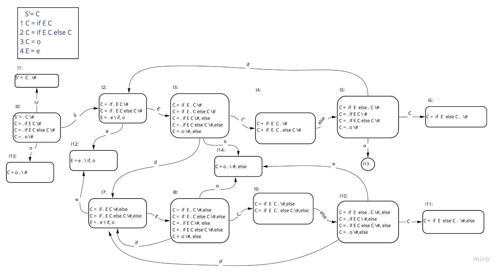

> Nota: na imagem, os estados I5 e I6 aparecem escritos `C = if E else . C` / `C = if E else C .`, sem o `C` do meio. O certo é `C → if E C else . C` e `C → if E C else C .` (eles vêm do I4 por `else`).

Mesmo autômato redesenhado (itens resumidos):

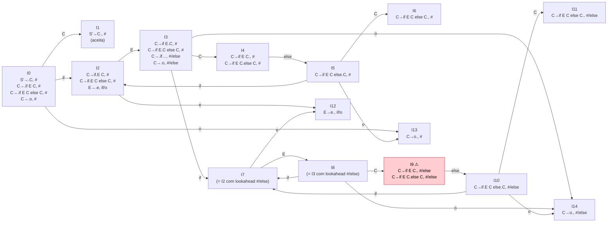

**Lendo os lookaheads (o que vem depois da vírgula):**
- `E → .e, if/o`: depois de `E` sempre vem um `C`, e um `C` começa com `if` ou `o` → `FIRST(C) = {if, o}`.
- No I3, os itens de fecho `C → .o` ganham lookahead `#/else`: esse `C` interno pode ser o "then" de um `if E C else C` (então depois dele pode vir `else`) ou o final de tudo (`#`).
- **Por que existem pares "gêmeos" (I2/I7, I3/I8, I4/I9, I5/I10, I6/I11, I13/I14)?** Porque o LR(1) **canônico** separa estados com o mesmo núcleo e lookaheads diferentes. Os da linha de cima (I2…I6) são o `if` **mais externo**, onde no fim só pode vir `#`. Os de baixo (I7…I11) são `if`s **aninhados**, onde depois pode vir um `else` de quem está por fora.

**Tabela Action/GoTo** (montada a partir do autômato; `sN` = shift pro estado N, `rN` = reduce pela regra N):

| Estado | `if` | `e` | `o` | `else` | `#` | GoTo `C` | GoTo `E` |
|---|---|---|---|---|---|---|---|
| I0 | s2 | | s13 | | | 1 | |
| I1 | | | | | **acc** | | |
| I2 | | s12 | | | | | 3 |
| I3 | s7 | | s14 | | | 4 | |
| I4 | | | | s5 | r1 | | |
| I5 | s2 | | s13 | | | 6 | |
| I6 | | | | | r2 | | |
| I7 | | s12 | | | | | 8 |
| I8 | s7 | | s14 | | | 9 | |
| I9 | | | | ⚠ **s10 / r1** | r1 | | |
| I10 | s7 | | s14 | | | 11 | |
| I11 | | | | r2 | r2 | | |
| I12 | r4 | | r4 | | | | |
| I13 | | | | | r3 | | |
| I14 | | | | r3 | r3 | | |

A **única célula com duas opções** é `I9 × else`, o famoso conflito do dangling else. Os dois exemplos a seguir mostram por que ele aparece e como o BYACC/J resolve.

> **E no LALR(1), que é o que o BYACC/J usa?** O LALR **funde** os estados com o mesmo núcleo: I2+I7, I3+I8, I4+I9, I5+I10, I6+I11, I13+I14. Aí os 15 estados viram 9. O estado fundido I4+I9 continua com o conflito em `else`. É por isso que o yacc reporta **1 shift/reduce conflict** pra essa gramática.

---

### 2.5.3 Colocando ações semânticas na gramática

Vamos fazer a tradução **construir uma AST**, que nem na seção 2.13. No BYACC/J:

```
%token IF ELSE
%token <sval> EXP CMD          /* "e" e "o" carregam um nome vindo do léxico */
%type  <sval> C E
%%
C : IF E C              { $$ = "If(" + $2 + ", " + $3 + ")"; }            /* regra 1 */
  | IF E C ELSE C       { $$ = "IfElse(" + $2 + ", " + $3 + ", " + $5 + ")"; } /* regra 2 */
  | CMD                 { $$ = $1; }                                       /* regra 3 */
  ;
E : EXP                 { $$ = $1; }                                       /* regra 4 */
  ;
```

- Os terminais `e` e `o` chegam com nome (`e₁`, `o₁`, …), que o JFlex coloca em `yylval`.
- **Cada reduce roda a ação da regra**, e o resultado (`$$`) é empilhado na pilha de valores.
- É uma SDD **S-atribuída**: só usa `$1 … $n`, então encaixa direto no LR.

---

### 2.5.4 ⭐ Exemplo prático 1 — `if e₁ o₁ else o₂ #` (sem ambiguidade)

| # | Pilha de estados | Símbolos | Valores | Entrada | Ação |
|---|---|---|---|---|---|
| 1 | `0` | | | `if e₁ o₁ else o₂ #` | **s2** |
| 2 | `0 2` | `if` | `–` | `e₁ o₁ else o₂ #` | **s12** |
| 3 | `0 2 12` | `if e` | `– e₁` | `o₁ else o₂ #` | **r4** `E → e`; GoTo(2, E) = 3 |
| 4 | `0 2 3` | `if E` | `– e₁` | `o₁ else o₂ #` | **s14** |
| 5 | `0 2 3 14` | `if E o` | `– e₁ o₁` | `else o₂ #` | **r3** `C → o`; GoTo(3, C) = 4 |
| 6 | `0 2 3 4` | `if E C` | `– e₁ o₁` | `else o₂ #` | **s5** |
| 7 | `0 2 3 4 5` | `if E C else` | `– e₁ o₁ –` | `o₂ #` | **s13** |
| 8 | `0 2 3 4 5 13` | `if E C else o` | `– e₁ o₁ – o₂` | `#` | **r3** `C → o`; GoTo(5, C) = 6 |
| 9 | `0 2 3 4 5 6` | `if E C else C` | `– e₁ o₁ – o₂` | `#` | **r2** (desempilha 5); GoTo(0, C) = 1 |
| 10 | `0 1` | `C` | `IfElse(e₁, o₁, o₂)` | `#` | **aceita** |

**O que aconteceu em cada passo, e por quê:**

1. **Passo 1:** em I0, o token é `if`. A tabela diz `s2`: existem itens `C → .if E C` e `C → .if E C else C`, então o `if` é consumido e os dois itens avançam o ponto, indo pro I2. **Nenhuma ação semântica**: shift só empilha. O valor do `if` é lixo (`–`).
2. **Passo 2:** em I2 o parser espera um `E`, e `E` começa com `e` → **s12**. O `yylval = "e₁"` vai junto pra pilha de valores.
3. **Passo 3 (primeiro reduce):** em I12 temos `E → e .` com lookahead `{if, o}`. O próximo token é `o`, que está no lookahead → **reduce pela regra 4**.
   - Ação semântica: `$$ = $1` → `$$ = "e₁"`.
   - Desempilha 1 estado (o 12) → topo volta a ser **2**.
   - **GoTo(2, E) = 3** → empilha o estado 3 com o valor `"e₁"`.
   - *Por que só agora?* O parser só sabe que o `E` acabou quando vê o token **seguinte** (o lookahead). Esse é o "1" do LR(1).
4. **Passo 4:** I3 espera um `C`; o token `o` inicia `C → .o` → **s14**.
   - *Por que I14 e não I13?* Porque estamos **dentro** de um `if`, então depois desse `C` pode vir um `else`. O I14 tem lookahead `{#, else}`, já o I13 só tem `#`.
5. **Passo 5:** em I14, `C → o .` com lookahead `else` → **r3**. Ação: `$$ = "o₁"`. Desempilha 1 → topo 3 → **GoTo(3, C) = 4**.
6. **Passo 6 (o ponto de decisão que NÃO é conflito):** I4 tem dois itens:
   - `C → if E C .` com lookahead `#` → reduziria **só** se viesse `#`;
   - `C → if E C . else C` → shift se vier `else`.
   O token é `else` → **s5**, sem dúvida nenhuma. **Sem conflito porque os lookaheads são disjuntos**: aqui o `if` é o mais externo, então um `else` só pode ser dele.
7. **Passos 7–8:** shift do `o₂` (vai pro I13, porque agora depois desse `C` só pode vir `#`), depois reduce `C → o` e **GoTo(5, C) = 6**.
8. **Passo 9 (o reduce grande):** I6 tem `C → if E C else C .` com lookahead `#` → **r2**.
   - O handle tem **5 símbolos**: `$1=if`, `$2="e₁"`, `$3="o₁"`, `$4=else`, `$5="o₂"`.
   - Ação: `$$ = "IfElse(e₁, o₁, o₂)"`.
   - Desempilha **5** estados (2 3 4 5 6) → topo **0** → **GoTo(0, C) = 1**.
9. **Passo 10:** I1 com `#` → **aceita**. A raiz da AST está no topo da pilha de valores.

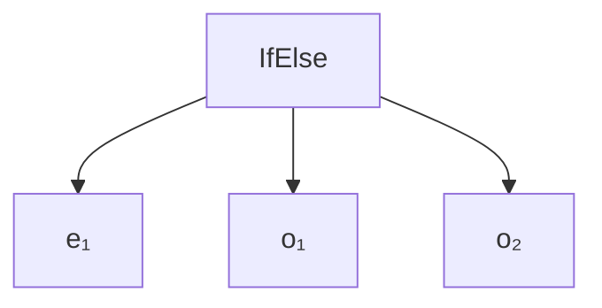

**Repara:** as ações rodaram na ordem **r4 → r3 → r3 → r2**, que é exatamente um **percurso pós-ordem** da árvore. Foi isso que a seção 1.4 quis dizer com "S-atribuída = pós-ordem = LR".

---

### 2.5.5 ⭐ Exemplo prático 2 — `if e₁ if e₂ o₁ else o₂ #` (o conflito do dangling else)

Agora com dois `if`s e um `else` só. **De qual `if` é o `else`?**

| # | Pilha de estados | Símbolos | Valores | Entrada | Ação |
|---|---|---|---|---|---|
| 1 | `0` | | | `if e₁ if e₂ o₁ else o₂ #` | s2 |
| 2 | `0 2` | `if` | `–` | `e₁ if …` | s12 |
| 3 | `0 2 12` | `if e` | `– e₁` | `if e₂ …` | r4; GoTo(2, E) = 3 |
| 4 | `0 2 3` | `if E` | `– e₁` | `if e₂ …` | **s7** |
| 5 | `0 2 3 7` | `if E if` | `– e₁ –` | `e₂ o₁ …` | s12 |
| 6 | `0 2 3 7 12` | `if E if e` | `– e₁ – e₂` | `o₁ else …` | r4; GoTo(7, E) = 8 |
| 7 | `0 2 3 7 8` | `if E if E` | `– e₁ – e₂` | `o₁ else …` | s14 |
| 8 | `0 2 3 7 8 14` | `if E if E o` | `– e₁ – e₂ o₁` | `else o₂ #` | r3; GoTo(8, C) = 9 |
| 9 | `0 2 3 7 8 9` | `if E if E C` | `– e₁ – e₂ o₁` | `else o₂ #` | ⚠ **s10 ou r1?** |

**Passos 1–8, explicados rapidinho:**
- Passos 1–3: igual ao exemplo 1. O reduce de `E → e₁` acontece com lookahead `if` (que também está em `FIRST(C)`).
- **Passo 4:** I3 vê outro `if` → **s7**, e não s2! O I7 é o "gêmeo de baixo" do I2: estamos num `if` **aninhado**, então tudo dali pra frente carrega lookahead `{#, else}`.
- Passos 5–8: reconhece `E → e₂` (GoTo(7, E) = 8) e `C → o₁` (GoTo(8, C) = 9).

**Passo 9, o conflito.** O I9 tem:
- `C → if E C . , #/else` → manda **reduzir** pela regra 1 se vier `else` (ou `#`);
- `C → if E C . else C , #/else` → manda **empilhar** o `else`.

O token é `else`, e **as duas ações são válidas**. Por quê? Porque o `else` poderia ser:
- do `if` **de dentro** (`if e₂ o₁ else o₂`), e aí é shift;
- do `if` **de fora**, depois de fechar o `if e₂ o₁` sem else, e aí é reduce.

A gramática é **ambígua**: a mesma entrada tem duas árvores. Vamos seguir os dois caminhos.

#### Caminho A — **shift** (o `else` fica com o `if` mais próximo)

| # | Pilha de estados | Valores | Entrada | Ação |
|---|---|---|---|---|
| 9 | `0 2 3 7 8 9` | `– e₁ – e₂ o₁` | `else o₂ #` | **s10** |
| 10 | `0 2 3 7 8 9 10` | `… o₁ –` | `o₂ #` | s14 |
| 11 | `… 10 14` | `… o₁ – o₂` | `#` | r3; GoTo(10, C) = 11 |
| 12 | `0 2 3 7 8 9 10 11` | `– e₁ – e₂ o₁ – o₂` | `#` | **r2**: desempilha 5 → topo 3; GoTo(3, C) = 4 |
| 13 | `0 2 3 4` | `– e₁ IfElse(e₂,o₁,o₂)` | `#` | **r1**: desempilha 3 → topo 0; GoTo(0, C) = 1 |
| 14 | `0 1` | `If(e₁, IfElse(e₂, o₁, o₂))` | `#` | aceita |

- **Passo 12:** o reduce pela regra 2 usa `$2 = "e₂"`, `$3 = "o₁"`, `$5 = "o₂"`. Ao tirar 5 estados (7 8 9 10 11), o topo vira **3**, que é o estado "dentro do `if` de fora, esperando o `C`". O `IfElse` inteiro vira o `C` do `if` externo.
- **Passo 13:** em I4 com `#` → **r1**: `$$ = If(e₁, IfElse(…))`.

#### Caminho B — **reduce** (o `else` vai pro `if` de fora)

| # | Pilha de estados | Valores | Entrada | Ação |
|---|---|---|---|---|
| 9 | `0 2 3 7 8 9` | `– e₁ – e₂ o₁` | `else o₂ #` | **r1**: desempilha 3 → topo 3; GoTo(3, C) = 4 |
| 10 | `0 2 3 4` | `– e₁ If(e₂,o₁)` | `else o₂ #` | s5 |
| 11 | `0 2 3 4 5` | `… –` | `o₂ #` | s13 |
| 12 | `… 5 13` | `… – o₂` | `#` | r3; GoTo(5, C) = 6 |
| 13 | `0 2 3 4 5 6` | `– e₁ If(e₂,o₁) – o₂` | `#` | **r2**: desempilha 5 → topo 0; GoTo(0, C) = 1 |
| 14 | `0 1` | `IfElse(e₁, If(e₂, o₁), o₂)` | `#` | aceita |

#### As duas ASTs lado a lado

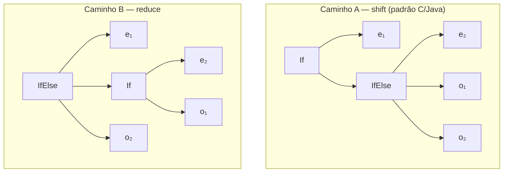

```
Caminho A:  if (e₁) { if (e₂) o₁; else o₂; }     ← o que C, Java, Pascal fazem
Caminho B:  if (e₁) { if (e₂) o₁; } else o₂;
```

**O ponto central pra semântica:** o conflito não é só um problema "de sintaxe". **A ação semântica que roda é diferente** em cada caminho: no A roda `IfElse` primeiro e `If` depois; no B é o contrário. Isso gera **ASTs diferentes**, e programas com **significados diferentes**. Se `e₁` for verdadeiro e `e₂` falso, o A executa `o₂` e o B não executa nada.

#### Como o BYACC/J resolve

1. **Sem fazer nada:** o BYACC/J avisa `1 shift/reduce conflict` e **escolhe shift por padrão** (caminho A). Funciona, mas fica um aviso que pode esconder conflitos novos. Com `byaccj -v`, o `y.output` mostra o estado (I4+I9 no LALR) e o conflito.
2. **Do jeito limpo, com precedência:** que é exatamente o que a gramática do Mini faz (seção 6.9):

```
%nonassoc IFX      /* token fictício: precedência MENOR */
%nonassoc ELSE     /* declarado depois: precedência MAIOR */
%%
C : IF E C  %prec IFX      { $$ = "If(" + $2 + ", " + $3 + ")"; }
  | IF E C ELSE C          { $$ = "IfElse(" + $2 + ", " + $3 + ", " + $5 + ")"; }
  ;
```

**Como a tabela é preenchida com isso:** na célula `I9 × else`, o gerador compara
- a precedência da **regra** que seria reduzida (regra 1, que ganhou a precedência de `IFX` via `%prec`)
- com a precedência do **token** que seria empilhado (`ELSE`).

`ELSE` foi declarado **depois**, então tem precedência maior → **shift**. A célula fica só com `s10`, sem aviso.

> É **a mesma regra** que fez o `*` ganhar do `+` no passo 5 da seção 2.8: lá o conflito era "reduzo `exp + exp` ou empilho `*`?". Precedência é **sempre** isso: um desempate pra células da tabela Action.

---

### 2.5.6 ⭐ Exemplo prático 3 — quando uma ação no meio **cria** um conflito

Suponha que você queira abrir um escopo assim que reconhece a condição do `if` (pra declarar variáveis dentro do "then", por exemplo):

```
C : IF E { abreEscopo(); } C            /* regra 1 com ação no meio */
  | IF E C ELSE C
  | CMD
  ;
```

**O que o gerador faz** (seção 1.9): troca a ação por um marcador ε.

```
C   : IF E $$1 C
    | IF E C ELSE C
    | CMD ;
$$1 : /* ε */  { abreEscopo(); } ;
```

**Agora olha o estado depois de `if E`** (o antigo I3):

```
C   → if E . $$1 C        ← pra continuar aqui, preciso REDUZIR $$1 → ε  AGORA
C   → if E . C else C     ← pra continuar aqui, preciso fazer SHIFT do começo de C
$$1 → .                   lookahead: FIRST(C) = { if, o }
C   → . if E C …          (fecho)   → shift em 'if'
C   → . o                 (fecho)   → shift em 'o'
```

Com o token `o` (ou `if`) à frente:
- **reduce** `$$1 → ε` (pra rodar `abreEscopo()` e seguir pela regra 1), **ou**
- **shift** `o` (seguindo pela regra 2, que não tem ação ali).

→ **conflito shift/reduce em `if` e em `o`.**

**Por quê?** O parser teria que decidir **se roda a ação ou não** antes de saber se vai aparecer um `else` lá na frente. Com 1 token de lookahead isso é impossível: o `else` pode estar a centenas de tokens de distância, depois de todo o comando `C`.

**Tentativa 2: pôr a ação nas duas regras.**

```
C : IF E { abreEscopo(); } C
  | IF E { abreEscopo(); } C ELSE C
```

Também não resolve. O gerador cria **dois marcadores diferentes** (`$$1` e `$$2`), mesmo com código idêntico, e aí vira um conflito **reduce/reduce** (`$$1 → ε` ou `$$2 → ε`?).

**A solução certa é fatorar** num não-terminal próprio, igual ao `cab_func` do Mini (seção 6.6):

```
cab_if : IF E          { abreEscopo(); $$ = $2; } ;
C      : cab_if C  %prec IFX       { fechaEscopo(); $$ = "If(" + $1 + ", " + $2 + ")"; }
       | cab_if C ELSE C           { fechaEscopo(); $$ = "IfElse(" + $1 + ", " + $2 + ", " + $4 + ")"; }
       | CMD                       { $$ = $1; }
       ;
```

**Por que isso funciona?** Agora as **duas** alternativas começam com o mesmo símbolo `cab_if`. Depois de `if E`, o parser **sempre** reduz `cab_if → IF E`, não importa se vai ter `else` ou não. Não sobra decisão pra tomar → a ação roda em ambos os casos, sem conflito. A decisão "tem else ou não" fica pra depois do `C`, que é onde o `%prec IFX` resolve (exemplo 2).

> **Moral:** no LR, uma ação no meio obriga o parser a **decidir mais cedo**. Se naquele ponto ainda existem caminhos diferentes possíveis (com e sem a ação), dá conflito. Fatorar faz todos os caminhos **compartilharem** o mesmo prefixo, e a ação passa a rodar num **reduce** comum a todos.

---

### 2.5.7 Resumo da ponte LR ↔ TDS

```
┌──────────────────────────────────────────────────────────────────────┐
│ SHIFT     → empilha estado + yylval.  Nenhuma ação semântica roda.   │
│ REDUCE    → AQUI rodam as ações: $1..$n = handle, $$ = novo valor.   │
│             Desempilha n, GoTo(topo, A), empilha $$.                 │
│ ORDEM     → reduces acontecem em PÓS-ORDEM → S-atribuída de graça.   │
│ LOOKAHEAD → decide QUANDO reduzir (LR(1): olha 1 token à frente).    │
│ CONFLITO  → célula da Action com 2 opções = ações semânticas         │
│             diferentes = ASTs/significados diferentes.               │
│ %prec     → desempate: prec(regra) × prec(token). Maior ganha.       │
│ AÇÃO NO   → marcador ε = decisão antecipada → conflito.              │
│  MEIO       Solução: fatorar (cab_if, cab_func).                     │
│ HERDADO   → pai só nasce no reduce → use sintetizado, $0 ou global.  │
└──────────────────────────────────────────────────────────────────────┘
```

---

## Parte 3 — Análise semântica & Tabela de Símbolos

### 3.1 Por que a gramática não basta?

Esse programa é **sintaticamente perfeito**, mas cheio de problemas:

```c
string nome;
void faz() {
    int x[10];
    x = "abc";            // tipo errado
    x[2] = nome * y;      // * em string; y nem existe
}
void faz() { }            // redefinição
int fib(int n) {
    return faz() + fib(n - 1);   // void + int
}
// e não tem main
```

Algumas restrições são **impossíveis de expressar com GLC**:
- **Declarar antes de usar** ≈ `L₁ = { wcw | w ∈ (a|b)* }` (o 1º `w` é a declaração, o 2º o uso).
- **Nº de parâmetros = nº de argumentos** ≈ `L₂ = { aⁿbᵐcⁿdᵐ }`.
- Nenhuma das duas é livre de contexto (lema do bombeamento).

**Solução:** a gramática aceita um **superconjunto** da linguagem; a análise semântica **filtra** o que não faz sentido. Ferramentas: **TDS** + **tabela de símbolos** (que "lembra" o contexto que a GLC não consegue lembrar).

### 3.2 Validade ≠ Correção

Objetivos (que conflitam entre si):
- Rejeitar o **máximo** de programas incorretos.
- Aceitar o **máximo** de programas corretos.
- Fazer isso **rápido**.

→ Análise estática é sempre **conservadora**.

| Inválido mas seguro | Válido mas errado |
|---|---|
| `if (false) { x = 137; }` com `x` string | `fib` que sempre retorna 0 |
| **Rejeitado** — o verificador não "roda" o programa, não sabe que o `if` nunca executa | **Aceito** — é semanticamente válido. Correção é papel de **testes** e verificação formal |

### 3.3 Duas formas de implementar

| | Ações durante o parsing | Percurso da AST |
|---|---|---|
| Como | ações em cada produção (`$$`, `$1`…) | constrói a AST e visita os nós |
| Passadas | **uma** | duas ou mais |
| Vantagem | simples e eficiente | modular; ordem livre das declarações |
| Limitação | nome precisa ser declarado **antes** do uso | mais memória e código |
| Linguagens | C, Pascal | Java, C# |

```java
// Java — compila (várias passadas: coleta nomes de classes antes)
class A { private B meuB; }
class B { private A meuA; }
```
```cpp
// C++ — erro: B não declarado (processa em ordem)
class A { B* meuB; };   // precisa de "class B;" antes
class B { A* meuA; };
```

> Ambas são TDS — só muda **QUANDO** as regras são avaliadas.

---

### 3.4 Tabela de símbolos: o que ela faz

Um mapa **nome → (classe, tipo, valor, endereço, parâmetros, …)**.

Operações:

| Operação | Quando |
|---|---|
| `insere(sím)` | declaração |
| `busca(nome)` | uso de um nome |
| `abreEscopo()` | entrada em bloco/função |
| `fechaEscopo()` | saída: descarta os locais |

Atributos típicos:

| Atributo | Pra que tipo de nome | Usado em |
|---|---|---|
| classe (kind) | todos | semântica |
| tipo | variáveis, constantes, funções | verificação de tipos |
| valor | constantes | constant folding |
| endereço/deslocamento | variáveis e parâmetros | geração de código |
| nível (escopo) | variáveis | escopo, acesso não local |
| nº e tipos dos parâmetros | funções | verificação de chamadas |
| campos | registro/classe | acesso a membros |
| linha da declaração | todos | mensagens de erro |

### 3.5 Estruturas de dados

Mesmas declarações (`const int n = 10; class T {...} int a, b, c; void M() {...}`) em três organizações:

```
LISTA LINEAR
 [n|Const] → [T|Type] → [a|Field] → [b|Field] → [c|Field] → [M|Meth]

ÁRVORE BINÁRIA DE BUSCA            TABELA HASH (encadeamento)
            n                       0 │ → [n] → [M]
          ╱   ╲                     1 │ → [b]
         M     T                    2 │ → [c] → [a]
        ╱                           3 │ → [T]
       b
      ╱ ╲
     a   c
```

| | Lista | Árvore | Hash |
|---|---|---|---|
| Busca | O(n) | O(log n)* | **O(1) médio** |
| Ordem | mantida | perdida | perdida |
| Prós/contras | simples; lenta com muitos nomes | *se balanceada | mais memória; **usual na prática** |

> Na prática: cada escopo tem poucos nomes → **lista ou hash por escopo**. Em Java: `HashMap` / `LinkedHashMap` (mantém a ordem).

### 3.6 Representando um símbolo

| Hierarquia de classes | Classe "plana" |
|---|---|
| `Símbolo ← Const, Var, Param, Tipo, Método` | um campo `kind` + todos os atributos |
| elegante, mas exige casts/`instanceof` em todo uso | campos que não se aplicam ficam sem uso |
| viável com `sealed` + records + switch com padrões | **escolha da prática** |

```java
class Symbol {
    enum Kind { CONST, GLOBAL, FIELD, ARG, LOCAL, TYPE, METH, PROG }
    Kind   kind;
    String name;
    Struct type;     // nó de estrutura do tipo
    Symbol next;     // próximo no mesmo escopo
    int    val;      // CONST: valor
    int    adr;      // ARG, LOCAL: endereço
    int    nArgs;    // METH: nº de argumentos
    int    nLocs;    // METH: nº de variáveis locais
    Symbol locals;   // METH: parâmetros e locais
}
```

### 3.7 Inserindo um nome — passo a passo

```java
static Symbol insert(Symbol.Kind kind, String name, Struct type) {
    Symbol sym = new Symbol(name, kind, type);            // (1)
    if (kind == Symbol.Kind.ARG)   sym.adr = topScope.nArgs++;   // (3)
    else if (kind == Symbol.Kind.LOCAL) sym.adr = topScope.nLocs++;
    Symbol cur = topScope.locals, last = null;
    while (cur != null) {                                 // (2)
        if (cur.name.equals(name)) error(name + " declarado duas vezes");
        last = cur; cur = cur.next;
    }
    if (last == null) topScope.locals = sym; else last.next = sym;   // (5)
    return sym;                                           // (6)
}
```

1. **Cria** o nó com `kind`, `name`, `type`.
2. **Procura duplicata** no escopo corrente → erro "declarado duas vezes".
3. Dá **endereços consecutivos** pra parâmetros e locais (`x` → adr 0, `y` → adr 1...).
4. Registra o **nível** (0 = global, 1 = local…).
5. **Acrescenta no fim** da lista do escopo (a ordem importa pros endereços!).
6. **Devolve o nó** — o chamador pode completar depois (ex.: nº de parâmetros só se sabe no fim).

### 3.8 Tipos dentro da tabela: nós de estrutura

Cada símbolo **aponta** pra um nó que descreve a estrutura do tipo:

```
int a, b; char c;           int[] v;                 class C { int x, y; } C o;

[Local a]──┐                [Local v]                [Global o]
[Local b]──┴──→ (Int)            │                        │
[Local c]─────→ (Char)           ▼                        ▼
                              (Arr)──elemType──→(Int)   (Class)──fields──→[Field x]→[Field y]
```

- **Um único nó `Int`** pra tabela toda → comparar tipos primitivos = **comparar referências** (`==`).
- O tamanho de um arranjo Java **não faz parte do tipo** (fica no objeto em execução).
- O nó da classe guarda a **lista de campos** — usada em `o.x`.
- Separar **símbolo** (o nome) de **estrutura** (o tipo) permite que vários símbolos compartilhem o mesmo tipo.

### 3.9 O "universo": nomes predefinidos

Um escopo **externo a tudo**, criado antes de ler o programa:

```
  ┌─ topo ── programa P (globais) ──────────────────┐
  │   a, b : Global int        M : Meth void        │
  ├─ externo ── universo ───────────────────────────┤
  │   int, char : Type    null : Const              │
  │   ord, chr, len : Meth     nullType   P : Prog  │
  └─────────────────────────────────────────────────┘
```

| `int` no universo (identificador comum) | `int` como palavra reservada |
|---|---|
| gramática mais simples (`Tipo → ident`) | o léxico resolve (token `INT`) |
| o nome pode até ser redefinido | gramática precisa de uma alternativa por tipo |
| | **é o que a prática com BYACC/J faz** |

---

## Parte 4 — Escopos

### 4.1 Conceitos

- **Escopo**: região onde um nome se refere a uma declaração. Delimitado por `{ }` (C/Java) ou `begin…end` (Pascal). Podem ser aninhados.
- **Escopo corrente**: o mais interno no ponto analisado.
- **Escopos abertos**: o corrente + todos que o envolvem. Os outros estão **fechados**.
- **Regra do aninhamento mais próximo**: vale a declaração **mais interna**; ela **oculta** (*shadowing*) as externas.

```c
int a;                 // global
void binky(int a) {    // parâmetro — oculta o global
    int a;             // ERRO em C! (parâmetro e corpo = mesmo escopo)
    a = 2;             // qual 'a'? → o mais próximo
}
```

> Em C, parâmetro e locais do corpo **compartilham o escopo**: ali é **redeclaração**. Num bloco interno `{ int a; }` seria **ocultação legal**. C não tem como alcançar o `a` global oculto (C++ tem `::a`).

### 4.2 ⭐ Passo a passo: a qual declaração cada uso se refere?

Notação **`x@n`** = o uso de `x` se refere à declaração da linha `n`.

```c
 0  int x = 137;
 1  int z = 42;
 2  int f(int x, int y) {
 3      print(x, y, z);
 4      {
 5          int x, z;
 6          z = y;
 7          x = z;
 8          {
 9              int y = x;
10              {
11                  print(x, y, z);
12              }
13              print(x, y, z);
14          }
15          print(x, y, z);
16      }
17  }
```

Visualizando os escopos como caixas:

```
┌─ global ─────────────── x@0  z@1  f ──────────────────────┐
│ ┌─ função f ────────── x@2  y@2 ───────────────────────┐  │
│ │  linha 3                                             │  │
│ │ ┌─ bloco (4) ─────── x@5  z@5 ────────────────────┐  │  │
│ │ │  linhas 6, 7, 15                                │  │  │
│ │ │ ┌─ bloco (8) ───── y@9 ──────────────────────┐  │  │  │
│ │ │ │  linhas 9, 13                              │  │  │  │
│ │ │ │ ┌─ bloco (10) ── (vazio) ───────────────┐  │  │  │  │
│ │ │ │ │  linha 11                             │  │  │  │  │
│ │ │ │ └───────────────────────────────────────┘  │  │  │  │
│ │ │ └────────────────────────────────────────────┘  │  │  │
│ │ └─────────────────────────────────────────────────┘  │  │
│ └──────────────────────────────────────────────────────┘  │
└───────────────────────────────────────────────────────────┘
```

| Linha | Uso | Resolve pra | Por quê |
|---|---|---|---|
| 3 | `print(x, y, z)` | `x@2 y@2 z@1` | `x` e `y` são parâmetros (escopo da função). `z` não existe na função → sobe pro global. |
| 6 | `z = y` | `z@5 y@2` | o bloco 4 declarou `z` (oculta o global). `y` não está no bloco → sobe pro parâmetro. |
| 7 | `x = z` | `x@5 z@5` | ambos declarados na linha 5. O `x@5` **oculta** o parâmetro `x@2`. |
| 9 | `int y = x` | `y@9` (decl.), `x@5` | declara um `y` novo (oculta o parâmetro). O `x` à direita sobe até o bloco 4. |
| 11 | `print(x, y, z)` | `x@5 y@9 z@5` | o bloco 10 é vazio → sobe tudo: `y` acha no bloco 8, `x` e `z` no bloco 4. |
| 13 | `print(x, y, z)` | `x@5 y@9 z@5` | ainda dentro do bloco 8 → mesma coisa. |
| 15 | `print(x, y, z)` | `x@5 y@2 z@5` | ⚠️ o bloco 8–14 **fechou** → o `y@9` morreu. Volta a valer o parâmetro `y@2`. |

### 4.3 Implementação: pilha de tabelas

Uma tabela (hash) **por escopo**; a pilha contém **exatamente os escopos abertos**.

| Operação | O que faz |
|---|---|
| `abreEscopo()` | empilha tabela vazia |
| `fechaEscopo()` | desempilha: descarta os locais |
| `insere(s)` | sempre na tabela do **topo** |
| `buscaLocal(n)` | só no topo → detecta **redeclaração** |
| `busca(n)` | do **topo pra base** → acha a declaração mais próxima |

Pilha **ao analisar a linha 11** do exemplo acima:

```
         ┌─────────────────────────────────────┐
  topo → │ bloco (linha 10)    (vazio)         │   busca começa aqui ↓
         ├─────────────────────────────────────┤
         │ bloco (linha 8)     y : int @9      │
         ├─────────────────────────────────────┤
         │ bloco (linha 4)     x : int @5      │
         │                     z : int @5      │
         ├─────────────────────────────────────┤
         │ função f            x : int @2      │
         │                     y : int @2      │
         ├─────────────────────────────────────┤
         │ global              x : int @0      │
         │                     z : int @1      │
         │                     f : (int,int)→int│
         └─────────────────────────────────────┘
```

`busca("y")`: topo vazio → bloco 8 tem `y` → **para**: `y@9`. Nunca chega no `y@2`.

- **Prós:** abrir/fechar é O(1); cada tabela fica imutável depois de preenchida.
- **Contra:** globais ficam no fundo → muitos níveis deixam a busca lenta.

### 4.4 Passo a passo: abrindo e fechando escopos de um método

```java
class P {
    int a, b;
    void M() {
        int x, y;
        ...
    }
}
```

```
  ① após "int a, b;"        ② dentro de M               ③ após o } de M
  ┌──────────────────┐     ┌──────────────────────┐     ┌──────────────────────────┐
  │ programa P       │     │ método M             │←topo│ programa P               │←topo
  │  a Global        │←topo│  x Local adr 0       │     │  a, b Global             │
  │  b Global        │     │  y Local adr 1       │     │  M Meth                  │
  ├──────────────────┤     ├──────────────────────┤     │    locals → [x, y]  ★    │
  │ universo         │     │ programa P           │     ├──────────────────────────┤
  │  int char P      │     │  a, b Global  M Meth │     │ universo                 │
  └──────────────────┘     ├──────────────────────┤     │  int char P              │
                           │ universo             │     └──────────────────────────┘
                           └──────────────────────┘
```

1. `Tab.openScope()` pro programa; `Tab.insert("a")`, `Tab.insert("b")`.
2. `Tab.insert("M")` — **o nome do método entra no escopo que o envolve** (o do programa), não no próprio escopo. Por isso dá pra chamar `M` de fora.
3. `Tab.openScope()` pro método; `Tab.insert("x")` (adr 0), `Tab.insert("y")` (adr 1).
4. No `}`: `m.locals = Tab.topScope.locals;` — **salva os locais dentro do símbolo do método** (o gerador de código vai precisar). Depois `Tab.closeScope()`.

**Nas ações semânticas:**

```
decl_metodo : tipo ID   { curMethod = Tab.insert(METH, $2, $1); Tab.openScope(); }
              '(' params ')' decl_locais '{' comandos '}'
                        { curMethod.nArgs  = Tab.topScope.nArgs;
                          curMethod.nLocs  = Tab.topScope.nLocs;
                          curMethod.locals = Tab.topScope.locals;
                          Tab.closeScope(); } ;
```

```java
static Symbol find(String name) {
    for (Scope s = topScope; s != null; s = s.outer)
        for (Symbol p = s.locals; p != null; p = p.next)
            if (p.name.equals(name)) return p;
    error(name + " não declarado");
    return noSym;   // ★ "coringa" em vez de null
}
```

> ⚠️ Devolver um símbolo **coringa** (`noSym`, com tipo `noType`) em vez de `null` evita `NullPointerException` e uma **avalanche de mensagens** pro mesmo erro.

### 4.5 Outras organizações

**Tabela hash única com número de escopo:**

```
h("x") → [x · esc 3] → [x · esc 2] → [x · esc 0]
          ↑ busca("x") para na PRIMEIRA = mais interna
```

- Cada entrada guarda o nº do escopo.
- Nomes novos entram **no início** da cadeia → a primeira achada é a mais interna.
- **Fechar** o escopo `n` = remover todas as entradas com nº `n` → pode ser caro.
  - *Truque:* manter, por escopo, uma lista das entradas inseridas → fechar custa O(k).

**Pilha espaguete (árvore de escopos):**

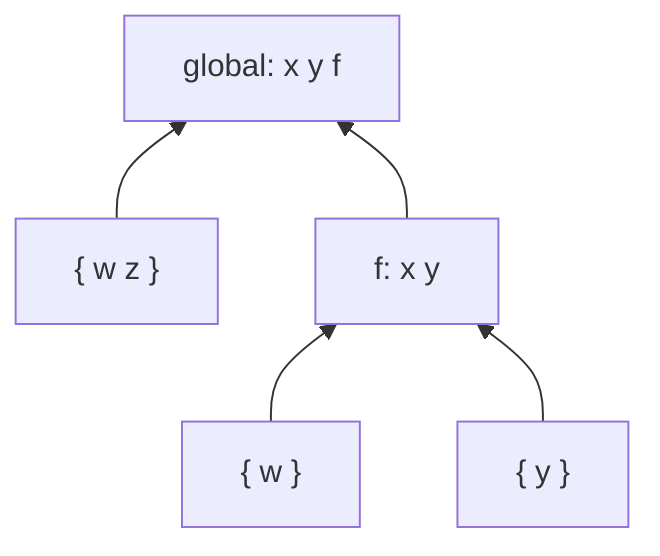

- Cada escopo aponta **só pro pai**; **nada é descartado**.
- De qualquer ponto, o caminho até a raiz "parece" uma pilha.
- É **estática** (fica disponível pra outras passadas). A pilha explícita é só uma otimização dinâmica dela.

### 4.6 ⭐ Escopo estático × dinâmico

```c
int x = 137;
int y = 42;
void f1() { print(x + y); }
void f2() { int x = 0; f1(); }
void f3() { int y = 0; f2(); }

f1(); f2(); f3();
```

| Chamada | Estático | Dinâmico |
|---|---|---|
| `f1()` | 179 | 179 |
| `f2()` | 179 | **42** (`x` de `f2`) |
| `f3()` | 179 | **0** (`x` de `f2`, `y` de `f3`) |

**Passo a passo:**

- **Estático** (olha o **texto**): `f1` foi **escrita** no nível global → `x` e `y` em `f1` são **sempre** os globais. Não importa quem chamou. → `137 + 42 = 179` nos três casos.
- **Dinâmico** (olha a **pilha de chamadas**):
  - `f1()` chamada direto: pilha = `[global, f1]` → acha `x=137`, `y=42` → **179**.
  - `f2()`: pilha = `[global, f2(x=0), f1]` → busca `x` de cima pra baixo: `f1` não tem, `f2` tem `x=0` → `x=0`; `y` só no global = 42 → **42**.
  - `f3()`: pilha = `[global, f3(y=0), f2(x=0), f1]` → `x` acha em `f2` = 0; `y` acha em `f3` = 0 → **0**.

```
 Pilha de chamadas em f3():
   ┌────────────┐
   │ f1         │ ← print(x + y): procura x e y daqui pra baixo
   │ f2  x = 0  │ ← acha x aqui
   │ f3  y = 0  │ ← acha y aqui
   │ global x=137, y=42 │
   └────────────┘
```

| Estático | Dinâmico |
|---|---|
| resolvido em **compilação** | resolvido em **execução** |
| compilador fixa o endereço de cada variável | nomes buscados na pilha de chamadas |
| C, Java, Pascal, Python | Perl (`local`), Lisp antigo, shell |
| | menos eficiente e mais difícil de entender |

### 4.7 Escopos em linguagens OO

O escopo da subclasse **aponta pro da superclasse** → a busca percorre a cadeia de herança.

```java
class Base    { public int publico = 1; protected int base = 2; }
class Derived extends Base {
    public int derivado = 3;
    public int publico  = 4;            // oculta Base.publico
    void faz() {
        print(publico);                 // 4
        print(base);                    // 2
        print(derivado);                // 3
        int publico = 6;
        print(publico);                 // 6
        print(this.publico);            // 4
        print(super.publico);           // 1
    }
}
```

```
  topo  → locais de faz()   publico = 6
              ↓
  this  → Derived           derivado = 3,  publico = 4,  faz
              ↓
  super → Base              publico = 1,   base = 2
```

**Passo a passo:**
- `print(publico)` (antes do local): começa no topo → locais vazios → `Derived` tem `publico = 4` → **4**.
- `print(base)`: locais não → `Derived` não → `Base` tem → **2**.
- Depois de `int publico = 6`: agora os locais têm `publico` → **6**.
- `this.publico`: `this` faz a busca **começar** em `Derived` (pula os locais) → **4**.
- `super.publico`: começa em `Base` → **1**.

> `this` e `super` são **ponteiros pra pontos específicos da cadeia**: a busca começa ali, e não no topo.

---

## Parte 5 — Sistemas de tipos

### 5.1 O que é um tipo?

> **Tipo = conjunto de valores + conjunto de operações sobre esses valores.**

- **Básicos**: `int`, `double`, `char`, `bool` (oferecidos pelo hardware).
- **Construídos**: arranjos, ponteiros, registros, classes, funções.
- **Erro de tipo**: aplicar uma operação a valores que não a suportam.
- **Expressão de tipo** (Aho 6.3.1): termo que descreve a estrutura — tipo básico ou construtor aplicado a expressões de tipo.

| Construtor | Exemplo C | Expressão de tipo |
|---|---|---|
| arranjo | `int v[10]` | `array(10, int)` |
| ponteiro | `char *s` | `pointer(char)` |
| registro | `struct {int n; char c;}` | `record((n×int)×(c×char))` |
| função | `double f(int, char)` | `int × char → double` |

**Exemplo montado:** `struct { char *s; int n; int nums[5]; } arr[12];`

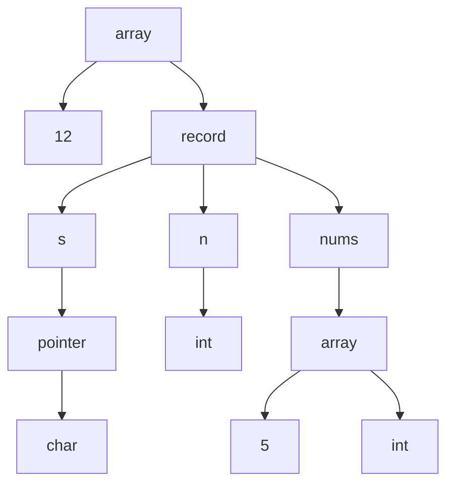

Lendo de cima pra baixo: "um arranjo de 12 registros, cada um com `s` (ponteiro pra char), `n` (int) e `nums` (arranjo de 5 ints)".

### 5.2 Classificação dos sistemas de tipos

| | Quando verifica | Exemplos | Característica |
|---|---|---|---|
| **Estática** | compilação | Java, C, Pascal, Haskell | usa declarações + tabela de símbolos |
| **Dinâmica** | execução | Python, Lisp, JavaScript | cada valor carrega uma etiqueta de tipo |
| **Forte** | — | Java, Python, Haskell | nenhum erro de tipo passa despercebido |
| **Fraca** | — | C, C++ | casts e aritmética de ponteiros "suspendem" a verificação |

> ⚠️ **Estática × dinâmica** e **forte × fraca** são **eixos independentes**. Python é dinâmica **e** forte; C é estática **e** fraca.

```c
double d = 3.14;
int *p = (int *) &d;   // cast: compila
*p = 42;               // corrompe d — tipagem fraca
```

> Estouro em `a * b` ou divisão por zero **não são detectáveis em compilação** → nenhuma verificação estática é "completa".

### 5.3 Projetando um verificador

1. Identificar os **tipos** da linguagem.
2. Identificar as **construções que têm tipo** (constantes, variáveis, funções, expressões).
3. Escrever as **regras semânticas** de cada construção.

**Tipos + construções + regras = sistema de tipos.**

| Síntese (bottom-up) | Inferência (ML, Haskell) |
|---|---|
| exige declarações | descobre os tipos pelo **uso** |
| se `f : s → t` e `x : s`, então `f(x) : t` | |

Na prática o mesmo percurso faz duas coisas: **(1)** infere o tipo de cada expressão; **(2)** confere se combina com o que o **contexto** espera.

```c
while (nbits(x+5) <= 10) {
    if (1.0 + 4.0) { … }      // tem tipo (double), mas o CONTEXTO exige bool
    while (5 == null) { … }   // não tem tipo NENHUM: erro dentro da expressão
}
```

### 5.4 Tipos como sistema de prova (regras de inferência)

**Notação:** `⊢ e : T` = "podemos provar que `e` tem tipo `T`".
Lê-se: **premissas em cima da linha, conclusão embaixo**.

```
                       i é const. inteira          ⊢ e1 : int    ⊢ e2 : int
 ───────────── (axioma)  ──────────────── (const)   ─────────────────────── (soma int)
 ⊢ true : bool             ⊢ i : int                  ⊢ e1 + e2 : int

 ⊢ e1 : double   ⊢ e2 : double            ⊢ e1 : T   ⊢ e2 : T   T é primitivo
 ───────────────────────────── (soma real) ──────────────────────────────── (igualdade)
     ⊢ e1 + e2 : double                           ⊢ e1 == e2 : bool
```

#### Passo a passo: provando `137 + 42 : int`

```
   137 é const. inteira       42 é const. inteira
   ──────────────────── (const)  ─────────────────── (const)
       ⊢ 137 : int               ⊢ 42 : int
   ─────────────────────────────────────────────── (soma int)
                 ⊢ 137 + 42 : int
```

1. `137` é constante inteira → regra **const** → `⊢ 137 : int`.
2. `42` idem → `⊢ 42 : int`.
3. As duas premissas da **soma int** estão satisfeitas → conclui `⊢ 137 + 42 : int`.

É uma **árvore de derivação** igualzinha às de gramática — só que provando tipo.

### 5.5 Faltou o contexto: `S ⊢ e : T`

Sem escopo, dá pra provar coisa contraditória:

```c
int f(int x) {
    { double x; }
    if (x == 1.5) { … }
}
```

**Problema:** a regra "se `x` é variável de tipo `T` então `⊢ x : T`" deixa provar `⊢ x : double` (do bloco **já fechado**!) e aí `x == 1.5 : bool`. Mas o `x` certo é `int`!

**Solução:** colocar o **escopo `S`** na regra. `S ⊢ e : T` = "no escopo `S`, `e` tem tipo `T`". Na implementação, **`S` é a própria tabela de símbolos** no ponto de análise.

```
 x é variável em S, tipo T              S ⊢ e1 : T[]   S ⊢ e2 : int
 ───────────────────────── (variável)   ─────────────────────────── (indexação)
       S ⊢ x : T                              S ⊢ e1[e2] : T

 f é função em S, f : (T1,…,Tn) → U     S ⊢ ei : Ti  (1 ≤ i ≤ n)
 ──────────────────────────────────────────────────────────────── (chamada)
                     S ⊢ f(e1,…,en) : U
```

### 5.6 Subtipos: a relação `≤`

**`A ≤ B`**: um valor do tipo `A` pode ser usado onde se espera `B`.

- Reflexiva (`A ≤ A`), transitiva, antissimétrica → **ordem parcial** dada pela herança.
- Primitivos e arranjos só são `≤` a si mesmos.
- `null` tem tipo especial `nulltype`, e `nulltype ≤ A` pra **toda classe** `A`.

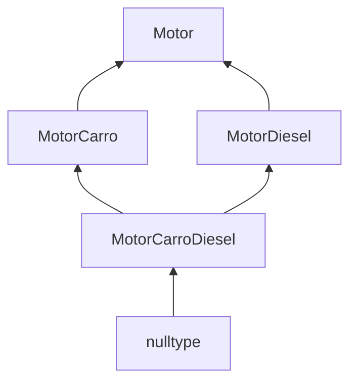

(herança múltipla: a hierarquia é um **grafo**, não uma árvore)

Regras atualizadas com subtipos:

```
 S ⊢ e1 : T1   S ⊢ e2 : T2   T2 ≤ T1           ← atribuição: o da direita tem
 ──────────────────────────────────                que "caber" no da esquerda
        S ⊢ e1 = e2 : T1

 S ⊢ e1 : T1   S ⊢ e2 : T2   T1 ≤ T2 ou T2 ≤ T1  ← igualdade: basta um caber
 ────────────────────────────────────────────        no outro
        S ⊢ e1 == e2 : bool

 f : (T1,…,Tn) → U   S ⊢ ei : Ri   Ri ≤ Ti        ← chamada: cada argumento
 ─────────────────────────────────────────            cabe no parâmetro
        S ⊢ f(e1,…,en) : U
```

### 5.7 Comandos: provas de boa formação `S ⊢ WF(cmd)`

Comando não tem *tipo*; ele é **bem formado** (*well-formed*) ou não.

| Comando | Precisa de |
|---|---|
| `e;` | `e` ter algum tipo |
| `c1 c2` | `c1` e `c2` bem formados |
| `break;` | estar **dentro de um laço** |
| `return;` | estar em função **void** |
| `return e;` | função retorna `T`, `e : T'` com `T' ≤ T` |
| `while (e) c` | `e : bool` e `c` bem formado no escopo do laço |
| `{ decls c }` | **abre escopo** `S' = S + decls`, `c` bem formado em `S'` |

**Algoritmo:** percorrer a árvore (ou executar ações na redução); pra cada comando, tipar as subexpressões, verificar os filhos e checar a regra do próprio comando.

### 5.8 Equivalência de tipos: por nome × estrutural

**Quando dois tipos são "o mesmo tipo"?**

```pascal
type pequeno = array[1..5]  of integer;
     curto   = array[1..5]  of integer;
     grande  = array[1..10] of integer;
var a, b : array[1..5] of integer;
    c    : array[1..5] of integer;
    d, e : pequeno;
    f, g : curto;
    h, i : grande;
```

| Par | Por nome | Estrutural | Por quê |
|---|---|---|---|
| `d, e` | ✔ | ✔ | mesmo nome `pequeno` |
| `a, b` | ✔ | ✔ | mesma declaração |
| `a, c` | ✘ | ✔ | dois tipos anônimos distintos, mas mesma estrutura |
| `d, f` | ✘ | ✔ | `pequeno` ≠ `curto` de nome, estrutura igual |
| `a, d` | ✘ | ✔ | anônimo vs `pequeno` |
| `d, h` | ✘ | ✘ | tamanhos diferentes → estrutura diferente |

- **Por nome**: iguais só com o mesmo nome (rápido, simples). Pascal, Java, C#.
- **Estrutural**: iguais se as **árvores de tipo coincidem**. Modula-3, Algol 68.
- **C**: structs por nome; `typedef` é só sinônimo.

**Testando equivalência estrutural (recursivo):**

```java
static boolean equivalentes(Tipo a, Tipo b) {
    if (a == b) return true;                 // mesmo nó
    if (a.cat != b.cat) return false;        // construtores diferentes
    switch (a.cat) {
        case INT, DOUBLE, CHAR, BOOL: return true;
        case POINTER: return equivalentes(a.elem, b.elem);
        case ARRAY:   return a.tam == b.tam && equivalentes(a.elem, b.elem);
        case RECORD:  /* compara campo a campo */ ...
    }
}
```

> ⚠️ **Tipo recursivo** (`struct no { int v; struct no *prox; }`) → **recursão infinita**!
> Soluções: marcar os pares `(a, b)` já em comparação (se reaparecer, assume "equivalentes"), ou usar equivalência por nome pra ponteiros/registros (é o que C faz).

### 5.9 Conversões e coerções

- **Coerção** = conversão **implícita** que o compilador insere.
- **Alargamento** (*widening*): preserva informação → pode ser implícito.
- **Estreitamento** (*narrowing*): pode perder informação → Java exige cast; C converte calado.

Alargamento em Java:

```
 byte → short → int → long → float → double
                 ↑
               char
 (seta = conversão segura/implícita; no sentido contrário, só com cast)
```

Soma com coerção (Aho):

```
E → E1 + E2 {
    E.tipo = max(E1.tipo, E2.tipo);
    a1 = widen(E1.end, E1.tipo, E.tipo);   // insere (double) se precisar
    a2 = widen(E2.end, E2.tipo, E.tipo);
    E.end = new Temp();
    gen(E.end '=' a1 '+' a2);
}
```

#### ⭐ Passo a passo: tipo de `f(a[i], 2) + 1.5`

Dados: `f : int × int → int`, `a : int[]`, `i : int`, e `int ≤ double` por coerção.

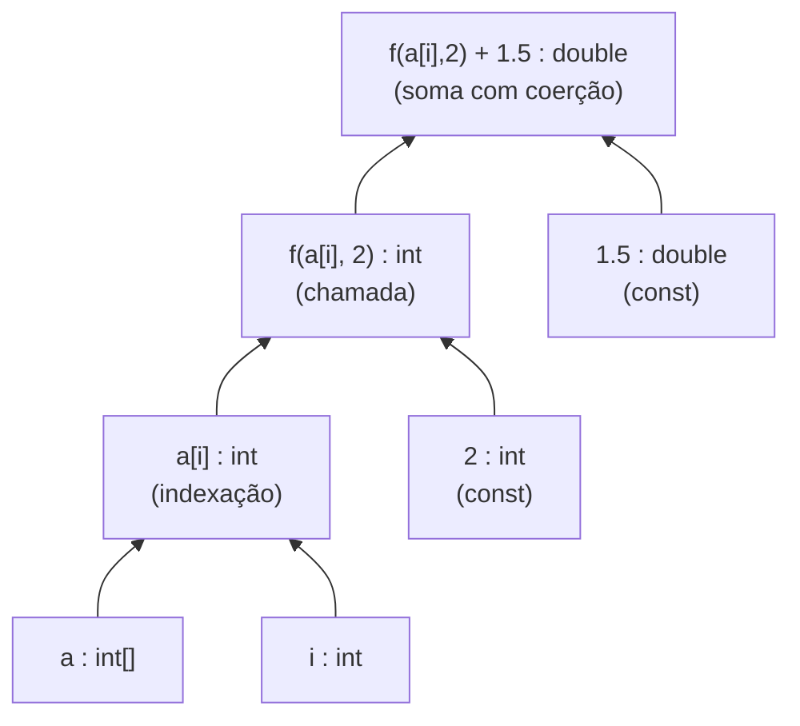

1. `S ⊢ a : int[]` e `S ⊢ i : int` → regra **indexação** → `S ⊢ a[i] : int`.
2. `S ⊢ 2 : int` (constante).
3. `f : int×int→int`, argumentos `int, int` batem → regra **chamada** → `S ⊢ f(a[i],2) : int`.
4. `S ⊢ 1.5 : double` (constante).
5. Soma de `int` com `double`: como `int ≤ double` e `double ≤ double` → `S ⊢ f(a[i],2) + 1.5 : double`.
6. O **gerador** insere a conversão: `(double) f(a[i],2) + 1.5`.

**Por quê precisa de subtipos aqui?** Sem eles, a regra "soma real" exigiria `⊢ e1 : double` — e `f(...)` tem tipo `int`. Falharia!

### 5.10 Tipo erro (⊥) e erros em cascata

```c
int x, y, z;
if (((x == y) > 5 && x + y < z) || x == z) { … }
```

**Sem ⊥**, um erro vira três mensagens:
```
erro: não é possível comparar bool > int
erro: && com operando ???
erro: || com operando ???
```

**Com ⊥** (*bottom*): ao detectar erro, a expressão recebe tipo `⊥`. Como **`⊥ ≤ A` pra todo `A`**, regras que recebem `⊥` **não emitem novas mensagens**.

#### Passo a passo

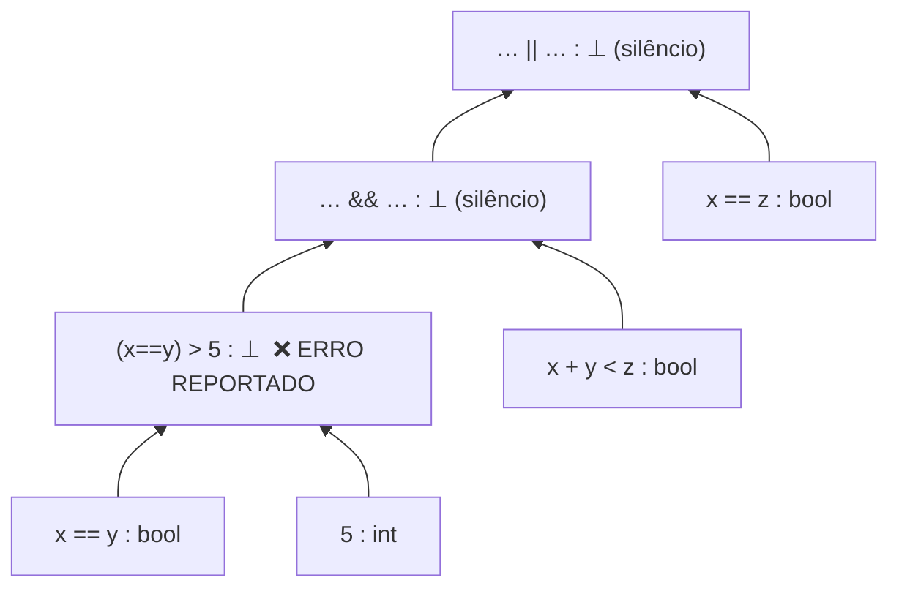

1. `x == y` → `bool`. ✔
2. `bool > int` → **erro reportado** → tipo vira `⊥`.
3. `⊥ && bool` → operando é `⊥` → **não reclama**, resultado `⊥`.
4. `⊥ || bool` → idem.
5. Resultado: **uma** mensagem só, apontando o erro real.

Dicas:
- Se o tipo do resultado **não depende** dos operandos (ex.: `<` sempre dá `bool`), devolva o tipo certo mesmo com erro.
- Identificador não declarado: insira na TS com tipo `⊥` pra avisar **uma vez só**.

### 5.11 Sobrecarga de funções

Mesmo nome, parâmetros diferentes; a escolha é **em compilação** pelos tipos dos argumentos.

**Algoritmo:**
1. **Filtra** as que não podem ser chamadas → conjunto de **candidatas**.
2. Nenhuma → erro. Uma → escolhida.
3. Várias → escolhe a **mais específica**.

**`A <: B`** (A mais específica que B) se `Aᵢ ≤ Bᵢ` pra todo `i`. A melhor é a que é `<:` **todas** as outras; se não existir → **ambígua**.

#### Passo a passo: `f(new Derived)`

```java
void f();  void f(int x);  void f(double x);  void f(Base b);  void f(Derived d);
```

1. **Filtro:** `f()` ✘ (aridade), `f(int)` ✘, `f(double)` ✘, `f(Base)` ✔ (`Derived ≤ Base`), `f(Derived)` ✔.
2. Candidatas: `(Base)` e `(Derived)`.
3. `Derived ≤ Base` ⇒ `(Derived) <: (Base)` ⇒ **`f(Derived)` vence**.

#### Exemplo ambíguo

```java
void g(Base a, Base b);
void g(Derived a, Base b);
void g(Base a, Derived b);
g(new Derived, new Derived);
```

1. As três são candidatas.
2. `(Derived, Base)` vs `(Base, Derived)`: a 1ª é mais específica no 1º parâmetro, a 2ª no 2º → **incomparáveis**.
3. Nenhuma é `<:` todas → **ambígua**.
4. **Correção:** adicionar `g(Derived, Derived)` — ela é `<:` todas e vira a melhor.

### 5.12 Sobrescrita: covariância × contravariância

O que a subclasse pode mudar na assinatura sem quebrar a segurança de tipos?

| Mudança | Seguro? | Exemplo |
|---|---|---|
| Retorno **mais específico** (covariante) | ✔ | `Derived clone()` sobrescreve `Base clone()` |
| Parâmetro **mais geral** (contravariante) | ✔ | `equalTo(Super)` sobrescreve `equalTo(Base)` |
| Parâmetro **mais específico** (covariante) | ✘ | `equalTo(Derived)` — chamada via `Base` passa um `Base` |
| Arranjos covariantes (`A[] = B[]`) | ✘ | Java verifica cada escrita em execução |

```java
class A { }  class B extends A { }
A[] arr = new B[10];     // aceito (covariância)
arr[0] = new A();        // ArrayStoreException!
```

**Por que quebra?** `arr` "parece" um `A[]`, mas na memória é um `B[]`. Colocar um `A` ali violaria o tipo real → Java pega em execução.

> **Regra de ouro:** *covariante no que devolve, contravariante no que recebe.* Por isso `Object.equals` recebe `Object`.

### 5.13 Inferência de tipos e polimorfismo

```sml
fun mult x = x * 10;          (* x : int  — 10 é int, então x também *)
fun sqr x = x * x;            (* ambíguo: int ou real? *)
fun sqr (x:int) = x * x;      (* resolvido *)
fun length L = if L = nil then 0 else 1 + length (tl L);
                              (* 'a list -> int  — funciona pra qualquer tipo *)
```

```java
var lista = new ArrayList<String>();         // var: Java 10+
static <T> int tamanho(List<T> l) { return l.size(); }   // polimórfica
int n = tamanho(List.of(1, 2, 3));           // T = Integer
```

- **Inferência**: atribui variáveis de tipo às expressões e resolve por **unificação**.
- **Polimorfismo paramétrico**: uma função opera em vários tipos (`length : 'a list → int`).
- **Sobrecarga** (polimorfismo *ad hoc*) **atrapalha** a inferência: em `sqr`, `*` existe pra `int` e pra `real`.
- **Polimorfismo de subtipo** (OO): resolvido com `≤` e despacho dinâmico.

---

## Parte 6 — Verificador "Mini" com BYACC/J

### 6.1 A linguagem Mini

Subconjunto de C:
- Tipos: `int`, `double`, `bool`, `void`, arranjos 1-D (`int v[10]`).
- Declarações globais, locais (em qualquer bloco) e parâmetros.
- Funções com recursão; precisa de `main`.
- Comandos: `=`, `if/else`, `while`, `break`, `return`, `print`, blocos.
- **Coerção implícita só `int → double`.**

```c
int n, v[10]; double media;
int fat(int k) {
    if (k <= 1) return 1;
    return k * fat(k - 1);        // recursão
}
double divide(double a, double b) { return a / b; }
void main() {
    int i;
    i = 0;
    while (i < 10) { v[i] = fat(i % 5); i = i + 1; }
    {
        double i;                 // oculta o 'i' de main
        i = 2.5;
        media = divide(v[3], i);  // int -> double
    }
    if (media > 1 && !(n == 0)) print(media);
}
```

### 6.2 Arquitetura

```mermaid
flowchart LR
    F["mini.flex"] -->|jflex| Y["Yylex.java"]
    G["mini.y"] -->|"byaccj -J -Jnorun"| P["Parser.java<br/>ParserVal.java"]
    Y --> P
    P --> T["Tipo.java<br/>(tipos e ≤)"]
    P --> S["Simbolo.java<br/>(entrada da TS)"]
    P --> TS["TabSimb.java<br/>(pilha de escopos)"]
    P --> D["DeclId.java<br/>(record auxiliar)"]
```

**Uma passada**: o léxico entrega tokens, o parser LALR(1) executa as ações semânticas a cada redução.

- `%type <obj> expr` → o atributo de `expr` é um **`Tipo`** guardado em `ParserVal.obj`.
- Por isso precisa de cast: `(Tipo)$1`.
- Estado do parser: `ts` (tabela), `funcAtual` (pra checar `return`), `laco` (profundidade, pra checar `break`), `nErros`.

### 6.3 `Tipo.java` — os tipos e a relação ≤

```java
public final class Tipo {
    public enum Cat { INT, DOUBLE, BOOL, VOID, ARRAY, ERRO }
    public static final Tipo INT  = new Tipo(Cat.INT,  null, 0);
    public static final Tipo BOOL = new Tipo(Cat.BOOL, null, 0);
    public static final Tipo ERRO = new Tipo(Cat.ERRO, null, 0);   // ⊥

    public boolean igual(Tipo o) {
        if (this == o) return true;                              // por nome
        return ehArray() && o.ehArray() && elem.igual(o.elem);
    }
    /** this ≤ dest ? */
    public boolean atribuivelA(Tipo dest) {
        if (ehErro() || dest.ehErro()) return true;              // ⊥ ≤ T
        if (ehArray() || dest.ehArray()) return false;
        return igual(dest) || (this == INT && dest == DOUBLE);   // coerção
    }
}
```

- **Objetos únicos** pra `int`, `double`, `bool` → comparar com `==` é comparar tipos.
- `ERRO` é aceito em qualquer lugar → o erro **já foi relatado**.
- `int → double` é a **única** conversão implícita.

### 6.4 `TabSimb.java` — pilha de `LinkedHashMap`

```java
private final Deque<Escopo> pilha = new ArrayDeque<>();

public void abreEscopo(String nome) { pilha.push(new Escopo(nome)); }
public void fechaEscopo()           { if (verbose) imprimeTopo(); pilha.pop(); }
public int  nivel()                 { return pilha.size() - 1; }
public void insere(Simbolo s)       { pilha.peek().simbolos.put(s.nome, s); }
public Simbolo buscaLocal(String n) { return pilha.peek().simbolos.get(n); }
public Simbolo busca(String nome) {          // topo -> base
    for (Escopo e : pilha) {
        Simbolo s = e.simbolos.get(nome);
        if (s != null) return s;
    }
    return null;
}
```

### 6.5 ⭐ Declarações: preenchendo a tabela

```
decl_var  : tipo lista_ids ';'   { declaraVars((Tipo)$1, (List<DeclId>)$2); } ;
lista_ids : item_id              { List<DeclId> l = new ArrayList<>();
                                   l.add((DeclId)$1); $$ = l; }
          | lista_ids ',' item_id { ((List<DeclId>)$1).add((DeclId)$3); $$ = $1; } ;
item_id   : ID                   { $$ = new DeclId($1, -1, linha()); }
          | ID '[' NUM_INT ']'   { $$ = new DeclId($1, $3, linha()); } ;
tipo      : INT { $$ = Tipo.INT; } | DOUBLE { $$ = Tipo.DOUBLE; } | BOOL { $$ = Tipo.BOOL; } ;
```

> Repare: aqui usaram a **saída nº 1** do herdado em LR — em vez de herdar o tipo pra cada `id`, a `lista_ids` **sintetiza** uma lista, e o tipo é aplicado lá em cima no `decl_var`.

#### Passo a passo: `int n, v[10];`

| # | Redução | `$$` resultante |
|---|---|---|
| 1 | `tipo → INT` | `Tipo.INT` |
| 2 | `item_id → ID` (`n`) | `DeclId("n", -1)` (-1 = não é arranjo) |
| 3 | `lista_ids → item_id` | `[n]` (cria a lista) |
| 4 | `item_id → ID '[' NUM_INT ']'` (`v[10]`) | `DeclId("v", 10)` |
| 5 | `lista_ids → lista_ids ',' item_id` | `[n, v]` (adiciona na mesma lista) |
| 6 | `decl_var → tipo lista_ids ';'` | `declaraVars(INT, [n, v])` → insere `n:int` e `v:int[10]` na TS |

E a função que efetivamente declara:

```java
boolean declara(Simbolo s) {
    Simbolo ant = ts.buscaLocal(s.nome);              // (1) já existe NESTE escopo?
    if (ant != null) {
        erro("'" + s.nome + "' já declarado neste escopo (linha " + ant.linha + ")");
        return false;
    }
    Simbolo ext = ts.busca(s.nome);                   // (2) existe em escopo EXTERNO?
    if (ext != null && ts.nivel() > 0)
        aviso("'" + s.nome + "' oculta a declaração da linha " + ext.linha);
    ts.insere(s);                                     // (3) insere no topo
    return true;
}
```

1. `buscaLocal` (só no topo) achou → **redeclaração** → **erro**.
2. `busca` (todos) achou em escopo externo → **ocultação** → só **aviso** (é legal!).
3. Insere.

### 6.6 Funções e escopos na gramática

```
decl_func : cab_func '(' params ')' corpo   { fechaFuncao(); } ;
cab_func  : tipo ID                         { abreFuncao($2, (Tipo)$1); }
          | VOID ID                         { abreFuncao($2, Tipo.VOID); } ;
param     : tipo ID                         { declaraParam($2, (Tipo)$1); } ;
corpo     : '{' itens '}'                   /* MESMO escopo dos params */ ;
bloco     : '{' { ts.abreEscopo("bloco"); } itens '}' { ts.fechaEscopo(); } ;
```

```java
void abreFuncao(String nome, Tipo ret) {
    funcAtual = new Simbolo(nome, FUNCAO, ret, 0, linha());
    declara(funcAtual);                    // entra no global ANTES do corpo → permite recursão
    ts.abreEscopo("função " + nome);
}
void declaraParam(String nome, Tipo t) {
    funcAtual.params.add(t);               // monta a assinatura
    declara(new Simbolo(nome, PARAM, t, ts.nivel(), linha()));
}
void fechaFuncao() { ts.fechaEscopo(); funcAtual = null; }
```

**Por que declarar a função antes do corpo?** Pra `fat` conseguir chamar `fat` dentro dela mesma (recursão). Se só declarasse no fim, `fat(k-1)` daria "não declarado".

**Por que `corpo` não abre escopo e `bloco` abre?** Porque em C parâmetros e corpo **compartilham** escopo (lembra do `binky`?).

> ⚠️ **Por que `cab_func` e não uma ação no meio tipo `tipo ID { … } '(' …`?**
> Depois de ler `tipo` com `ID` à frente, o parser **não sabe** se está numa **variável** (`int x;`) ou numa **função** (`int f(...)`). Se tivesse uma ação no meio, ele teria que decidir "reduzo o marcador ε agora ou empilho o `ID`?" → **conflito shift/reduce**. Criando uma produção própria `cab_func : tipo ID`, a redução só acontece **depois** do `ID`, quando o `(` já mostrou que é função.

### 6.7 Expressões: o tipo como atributo sintetizado

Cada redução de `expr` calcula `$$` a partir dos tipos dos filhos — **são as regras `S ⊢ e : T` virando código**.

```
expr : expr '+' expr        { $$ = aritmetico("+", (Tipo)$1, (Tipo)$3); }
     | expr '<' expr        { $$ = relacional("<", (Tipo)$1, (Tipo)$3); }
     | expr AND expr        { $$ = logico("&&", (Tipo)$1, (Tipo)$3); }
     | '-' expr %prec UMINUS { $$ = menosUnario((Tipo)$2); }
     | NUM_INT              { $$ = Tipo.INT; }
     | NUM_REAL             { $$ = Tipo.DOUBLE; }
     | TRUE                 { $$ = Tipo.BOOL; }
     | ID                   { $$ = usaVar($1); }
     | ID '[' expr ']'      { $$ = indexa($1, (Tipo)$3); }
     | chamada              { $$ = $1; } ;
```

```java
Tipo aritmetico(String op, Tipo a, Tipo b) {
    if (a.ehErro() || b.ehErro()) return Tipo.ERRO;        // sem cascata
    if (a.numerico() && b.numerico())
        return (a == Tipo.DOUBLE || b == Tipo.DOUBLE) ? Tipo.DOUBLE : Tipo.INT;  // max()
    erro("operador '" + op + "' não se aplica a " + a + " e " + b);
    return Tipo.ERRO;
}
Tipo usaVar(String nome) {
    Simbolo s = ts.busca(nome);
    if (s == null) { erro("identificador '" + nome + "' não declarado"); return Tipo.ERRO; }
    return s.tipo;
}
```

#### Passo a passo: `i % 5 + 2.5` com `i : int`

| # | Redução | `$$` | Por quê |
|---|---|---|---|
| 1 | `expr → ID` (`i`) | `INT` | `usaVar("i")` busca na TS |
| 2 | `expr → NUM_INT` (`5`) | `INT` | literal inteiro |
| 3 | `expr → expr '%' expr` | `INT` | `modulo(INT, INT)` |
| 4 | `expr → NUM_REAL` (`2.5`) | `DOUBLE` | literal real |
| 5 | `expr → expr '+' expr` | `DOUBLE` | `aritmetico`: ambos numéricos, um é `DOUBLE` → `max = DOUBLE` |

### 6.8 Chamadas e atribuições

```java
Tipo chama(String nome, List<Tipo> args) {
    Simbolo f = ts.busca(nome);
    if (f == null)                    { erro(...); return Tipo.ERRO; }
    if (f.classe != FUNCAO)           { erro("'" + nome + "' não é uma função"); return Tipo.ERRO; }
    if (args.size() != f.params.size())
        erro("'" + nome + "' espera " + f.params.size() + " argumento(s), recebeu " + args.size());
    else for (int i = 0; i < args.size(); i++)
        if (!args.get(i).atribuivelA(f.params.get(i)))
            erro("argumento " + (i+1) + " de '" + nome + "': esperado ...");
    return f.tipo;                    // ★ retorno conhecido MESMO com erro
}
```

Ordem de checagem: existe? → é função? → aridade bate? → cada argumento `≤` parâmetro? → devolve o tipo de retorno (mesmo com erro de argumento, porque a **assinatura é conhecida** — evita cascata).

```java
void atribui(String nome, Tipo tIdx, Tipo tExpr) {
    Tipo alvo;
    if (tIdx == null) {
        alvo = usaVar(nome);
        if (alvo.ehArray()) { erro("não é permitido atribuir ao arranjo inteiro"); return; }
    } else alvo = indexa(nome, tIdx);
    if (!tExpr.atribuivelA(alvo))
        erro("tipos incompatíveis na atribuição a '" + nome + "': esperado " + alvo + ", encontrado " + tExpr);
}
```

### 6.9 Comandos: regras de boa formação

```
cmd  : IF cond cmd %prec IFX
     | IF cond cmd ELSE cmd
     | WHILE cond { laco++; } cmd { laco--; }
     | BREAK ';'        { if (laco == 0) erro("'break' fora de um laço"); }
     | RETURN ';'       { checaReturn(null); }
     | RETURN expr ';'  { checaReturn((Tipo)$2); }
     | bloco ;
cond : '(' expr ')'     { checaCond((Tipo)$2); } ;
```

- `laco++` **antes** do corpo e `laco--` **depois**: um contador de profundidade. Se `break` aparecer com `laco == 0`, está fora de qualquer laço.
- Fatorar `'(' expr ')'` em `cond` evita repetir a checagem nos dois `if` e no `while`.

```java
void checaCond(Tipo t) {
    if (!t.ehErro() && t != Tipo.BOOL) erro("condição deve ser bool, encontrado " + t);
}
void checaReturn(Tipo t) {
    Tipo esp = funcAtual.tipo;
    if (esp == Tipo.VOID) { if (t != null) erro("função void não pode retornar valor"); }
    else if (t == null)   erro("'" + funcAtual.nome + "' deve retornar " + esp);
    else if (!t.atribuivelA(esp)) erro("retorno incompatível ...");
}
```

### 6.10 ⭐ Passo a passo: executando `erros.mini`

```c
14 void main() {
15     int v[5];
16     double d;
17     d = 3;               // OK: int -> double
18     x = d;
19     y = 2;
20     x = soma(1);
21     x = soma(1, true);
22     ok = x + 1;
23     if (x) print(x);
24     x = v;
25     v[d] = 1;
26     x = p() + 1;
27     x = (y + 1) * 2;
28     break;
29 }
```

*(Pelas mensagens, dá pra deduzir que nas linhas 1–13 existem: `x` global `int`, `ok` global `bool`, `soma(int, int)` e uma função `void p()`.)*

| Linha | Código | Mensagem | O que aconteceu |
|---|---|---|---|
| 4 | — | `'x' já declarado neste escopo (linha 2)` | `buscaLocal` achou `x` no mesmo escopo → redeclaração |
| 11 | — | `função void 'p' não pode retornar valor` | `checaReturn` com `esp == VOID` e `t != null` |
| 17 | `d = 3` | *(nenhuma)* ✔ | `INT.atribuivelA(DOUBLE)` → coerção permitida |
| 18 | `x = d` | `esperado int, encontrado double` | `DOUBLE ≤ INT`? Não — seria **estreitamento** |
| 19 | `y = 2` | `identificador 'y' não declarado` | `usaVar("y")` → `busca` retorna `null` |
| 20 | `x = soma(1)` | `'soma' espera 2 argumento(s), recebeu 1` | aridade não bate |
| 21 | `x = soma(1, true)` | `argumento 2 de 'soma': esperado int, encontrado bool` | `BOOL ≤ INT`? Não |
| 22 | `ok = x + 1` | `esperado bool, encontrado int` | `x + 1 : int`, `ok : bool` |
| 23 | `if (x)` | `condição deve ser bool, encontrado int` | `checaCond(INT)` |
| 24 | `x = v` | `esperado int, encontrado int[5]` | `atribuivelA` retorna `false` pra arranjo |
| 25 | `v[d] = 1` | `índice de 'v' deve ser int, ...` | `indexa` com índice `DOUBLE` |
| 26 | `x = p() + 1` | `operador '+' não se aplica a void e int` | `aritmetico(VOID, INT)` → erro → devolve `ERRO`. Aí `atribui` recebe `ERRO`, e `ERRO.atribuivelA(INT) = true` → **sem segunda mensagem** ✨ |
| 27 | `x = (y + 1) * 2` | `identificador 'y' não declarado` | `y` de novo! (veja abaixo) |
| 28 | `break;` | `'break' fora de um laço` | `laco == 0` |

**Resultado:** `13 erro(s) encontrado(s).` — **um erro por linha, nenhuma cascata**.

**Repara na linha 27:** `y` não declarado já foi reportado na linha 19, e é reportado **de novo**. Isso é a melhoria do exercício C5: ao achar um nome não declarado, **inserir na TS com tipo `ERRO`**:

```java
if (s == null) {
    erro("identificador '" + nome + "' não declarado");
    ts.insere(new Simbolo(nome, VAR_LOCAL, Tipo.ERRO, ts.nivel(), linha()));  // ★
    return Tipo.ERRO;
}
```

Assim, na linha 27 o `busca("y")` acharia o símbolo "falso" com tipo `ERRO` → nenhuma mensagem nova (`ERRO ≤ tudo`). Quando o escopo fecha, o símbolo falso some junto.

### 6.11 Executando com `-v`: a tabela em ação

Cada escopo é impresso **no momento em que fecha**:

```
┌─ fechando escopo 'função fat' (nível 1)
│ k        PARAM       int          nível 1 (linha 5)
└─
┌─ fechando escopo 'bloco' (nível 2)        ← corpo do while (vazio)
└─
Linha 22: aviso: 'i' oculta a declaração da linha 15
┌─ fechando escopo 'bloco' (nível 2)
│ i        VAR_LOCAL   double       nível 2 (linha 22)
└─
┌─ fechando escopo 'função main' (nível 1)
│ i        VAR_LOCAL   int          nível 1 (linha 15)
└─
┌─ fechando escopo 'global' (nível 0)
│ n        VAR_GLOBAL  int                    nível 0
│ v        VAR_GLOBAL  int[10]                nível 0
│ fat      FUNCAO      [int] -> int           nível 0
│ divide   FUNCAO      [double, double] -> double
│ main     FUNCAO      [] -> void             nível 0
└─
Programa semanticamente correto.
```

**Por que `double i` gera aviso e não erro?** O bloco interno abre um escopo novo (nível 2) → `buscaLocal("i")` não acha nada ali → não é redeclaração, é **ocultação** → `declara()` só avisa. Se estivesse direto no corpo de `main` (nível 1, onde já tem `int i`) → **erro**.

Pilha na linha 23 (`media = divide(v[3], i);`):

```
  topo → │ bloco (nível 2)      i : double              │  ← i resolve aqui
         │ função main (nível 1) i : int  (oculto)      │
         │ global (nível 0)  n, v, media, fat, divide, main │  ← v e divide resolvem aqui
```

`divide(v[3], i)`: `v[3] : int` vai pro parâmetro `double` (**coerção** ✔), `i : double` → `double` ✔.

### 6.12 Decisões de recuperação de erros

| Situação | O que o verificador faz | Por quê |
|---|---|---|
| Identificador não declarado | erro + devolve `ERRO` | o uso não tem tipo conhecido |
| Operação aritmética inválida | erro + devolve `ERRO` | int ou double? impossível saber |
| Relacional / lógico inválido | erro + devolve **`bool`** | o resultado é `bool` de qualquer forma |
| Argumentos errados na chamada | erro + devolve **tipo de retorno** | a assinatura é conhecida |
| Redeclaração | erro; mantém a 1ª declaração | usos seguintes continuam consistentes |
| Redeclaração de função | erro; corpo analisado mesmo assim | acha outros erros no corpo |
| Operando com tipo `ERRO` | nenhuma nova mensagem | evita cascata |

---

## Cola final

```
┌──────────────────────────────────────────────────────────────────────────┐
│ ATRIBUTOS   sintetizado ↑ (filhos → pai)   herdado ↓→ (pai/irmão esq.)    │
│             terminais recebem valor do léxico (lexval / yylval)          │
├──────────────────────────────────────────────────────────────────────────┤
│ SDD         gramática + regras. Ordem = ordenação topológica do grafo.   │
│ CLASSES     S-atribuída ⊂ L-atribuída                                    │
│             S ↔ LR (avalia na redução)   L ↔ LL (parâmetros/retorno)     │
├──────────────────────────────────────────────────────────────────────────┤
│ SDT         ações { } dentro do corpo; posição = QUANDO roda.            │
│             ação no meio ⇒ marcador M → ε (cuidado: conflitos!)          │
├──────────────────────────────────────────────────────────────────────────┤
│ HERDADO     1) reescrever como sintetizado (lista)                       │
│ NO LR       2) $0 (valor logo abaixo do corpo)                           │
│             3) estado global (tabela de símbolos, tipoAtual)             │
├──────────────────────────────────────────────────────────────────────────┤
│ BYACC/J     $$ = yyval   $k = val_peek(n-k)   $0 = val_peek(n)           │
│             ação padrão: $$ = $1  → '(' exp ')' precisa { $$ = $2; }      │
│             %token/%type <ival|dval|sval|obj>   JFlex preenche yylval    │
│             %left/%right/%nonassoc: linha de baixo = maior precedência   │
├──────────────────────────────────────────────────────────────────────────┤
│ TAB. SÍMB.  nome → atributos. Hash por escopo. Universo = predefinidos.  │
│ ESCOPOS     pilha de tabelas: insere/buscaLocal no topo, busca topo→base │
│             aninhamento mais próximo (shadowing). Estático ≠ dinâmico.   │
│             buscaLocal achou → ERRO (redecl.)  busca achou → AVISO (ocult)│
├──────────────────────────────────────────────────────────────────────────┤
│ TIPOS       S ⊢ e : T  (expressões)    S ⊢ WF(c)  (comandos)             │
│             A ≤ B: A cabe onde se espera B. nulltype ≤ classes. ⊥ ≤ tudo │
│             equivalência por nome × estrutural (cuidado: recursivos)     │
│             widening implícito; narrowing exige cast                     │
│             sobrecarga: candidata mais específica, senão ambígua         │
│             covariante no retorno, contravariante no parâmetro           │
│             ⊥ (ERRO) evita cascata: 1 erro real = 1 mensagem             │
└──────────────────────────────────────────────────────────────────────────┘
```
